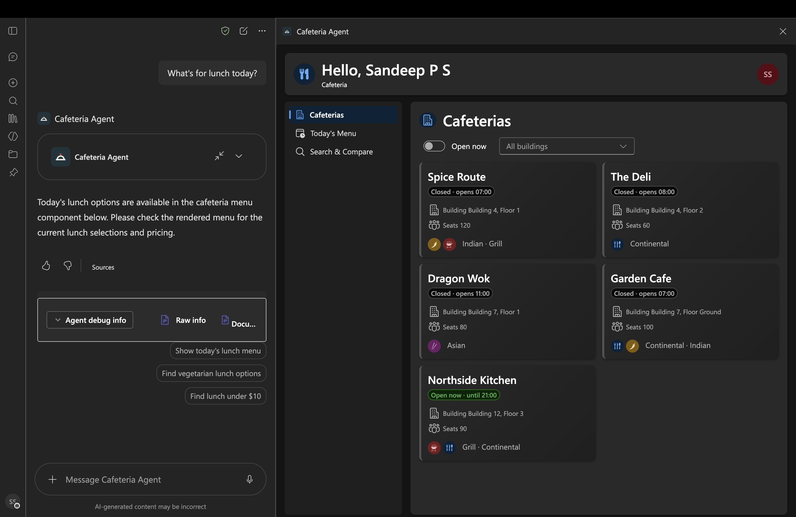
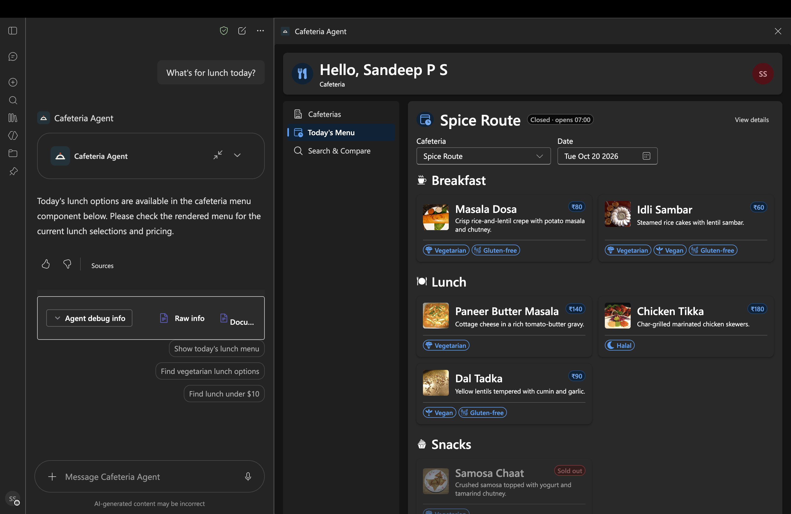
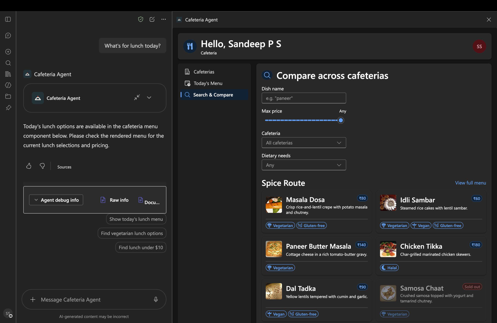
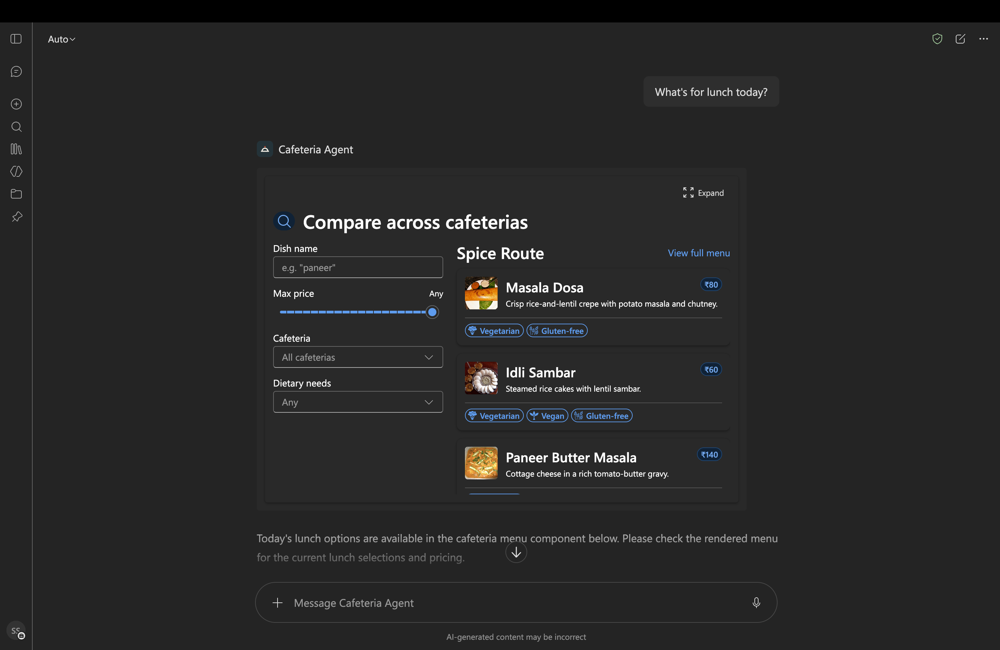

# Cafeteria - Browse Cafeterias and Menus in Copilot

## Summary

**Cafeteria** is an SPFx 1.24 Copilot Component sample that brings cafeteria listings, daily menus, dish search, and cafeteria details into Microsoft 365 Copilot. The Cafeteria Agent selects the matching tool from a natural-language request and renders an interactive result in the Copilot canvas.

The sample includes four tools:

- **Browse cafeterias** by building or whether they are open now
- **Show a menu** for a cafeteria and date, grouped by meal period
- **Search menu items** by dish name, dietary requirements, price, cafeteria, or date
- **Show cafeteria details**, including hours, floor, contact, payment methods, and closure notices

All tools use bundled synthetic data. No SharePoint lists, Microsoft Graph permissions, or other live data source are required.

## Screenshots

### Full screen







### Inline



## Compatibility


> SPFx Copilot Components are in preview. APIs and packaging behavior may change.

## Applies to

- [SharePoint Framework](https://learn.microsoft.com/sharepoint/dev/spfx/sharepoint-framework-overview) 1.24+ (Copilot Component)
- [Microsoft Copilot extensibility](https://learn.microsoft.com/microsoft-365-copilot/extensibility/)
- [Microsoft 365 tenant](https://learn.microsoft.com/sharepoint/dev/spfx/set-up-your-development-environment) with a SharePoint App Catalog

> Get your own free development tenant by subscribing to the [Microsoft 365 developer program](https://aka.ms/m365/devprogram).

## Prerequisites

- Node.js **>=22.14.0 and <23.0.0**
- A Microsoft 365 tenant with the SPFx Copilot Components preview enabled
- Access to the tenant's SharePoint App Catalog to deploy the solution
- [Heft](https://heft.rushstack.io/) (`npm install -g @rushstack/heft`), or run it with `npx heft`

The sample uses local synthetic data and does not request additional Microsoft Graph or SharePoint API permissions.

## Solution

- **Solution:** `cafeteria`
- **Agent:** Cafeteria Agent
- **Component type:** SPFx Copilot Component UX (`copilotType: "Ux"`)

## Version history

| Version | Date          | Comments        |
| ------- | ------------- | --------------- |
| 1.0.0 | October 19, 2026 | Initial release |

## Minimal path to awesome

### Run from source

1. Clone this repository and change to `samples/cafeteria`.
2. Install dependencies:

   ```bash
   npm install
   ```

3. Start the hosted Copilot workbench:

   ```bash
   npm run start
   ```

   The development server is configured to open the tenant's Copilot workbench. SPFx Copilot Components cannot be tested in the local SharePoint workbench.

4. To create a production package, run:

   ```bash
   npm run build
   ```

   This runs the production test/build and packages the solution as `sharepoint/solution/cafeteria.sppkg`.

### Deploy

1. Upload the generated `sharepoint/solution/cafeteria.sppkg` to the tenant **App Catalog**.
2. Select **Enable this app and add it to all sites**, then select **Enable app** to deploy the solution tenant-wide. This is required for Copilot integration.
3. In the App Catalog, select the app and choose **Add to Teams**. This provisions the Cafeteria Agent in Copilot.
4. In Microsoft Copilot, add or select **Cafeteria Agent** and start a new conversation to try its four tools.

## Features

- **Copilot agent tool routing** — the Cafeteria Agent routes requests to the narrowest matching tool: `getListCafeteria`, `getMenu`, `searchMenuItems`, or `getCafeteriaDetails`.
- **Cafeteria discovery** — list active cafeterias, optionally filtered by building or open status.
- **Menu browsing** — display a cafeteria's menu grouped by breakfast, lunch, and snacks.
- **Dish search** — filter today's menu by dish name, dietary tags, maximum price, or cafeteria.
- **Cafeteria details** — display location, hours, contact, payment options, and closure notices.
- **Inline and full-screen rendering** — each component supports both display modes and follows the Copilot host's theme.
- **Synthetic data service** — bundled sample data allows offline demos without tenant data connections. The sample menu data represents today's menus only; dates without seeded menus return an unpublished-menu state.

### Suggested prompts

- Which cafeterias are open now?
- What is for lunch at the cafeteria in Building 4?
- Find vegan dishes under 150.
- Show me the hours and payment options for the cafeteria in Building 4.

## References

- [Getting started with SharePoint Framework](https://learn.microsoft.com/sharepoint/dev/spfx/set-up-your-development-environment)
- [Microsoft 365 Copilot extensibility](https://learn.microsoft.com/microsoft-365-copilot/extensibility/)
- [Heft documentation](https://heft.rushstack.io/)
- [Microsoft 365 Patterns and Practices](https://aka.ms/m365pnp) — guidance, tooling, samples, and open-source controls for Microsoft 365 development

## Help

We do not provide support for individual samples, but the community is always willing to help improve them. Check [issues related to this sample](https://github.com/pnp/spfx-copilot-components/issues) or [create a new issue](https://github.com/pnp/spfx-copilot-components/issues/new).

## Disclaimer

**THIS CODE IS PROVIDED _AS IS_ WITHOUT WARRANTY OF ANY KIND, EITHER EXPRESS OR IMPLIED, INCLUDING ANY IMPLIED WARRANTIES OF FITNESS FOR A PARTICULAR PURPOSE, MERCHANTABILITY, OR NON-INFRINGEMENT.**


