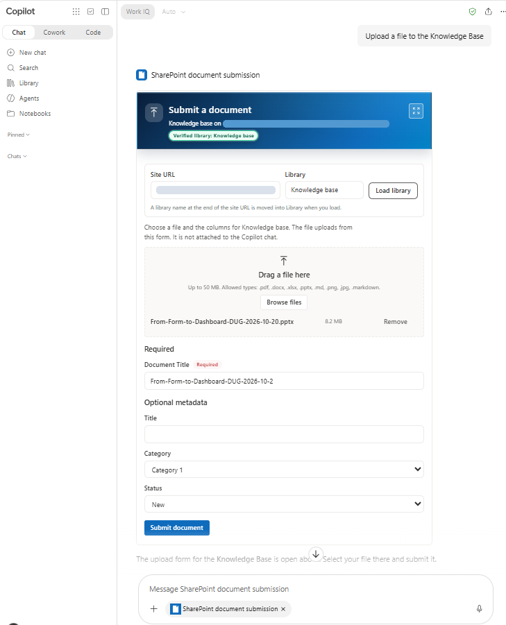
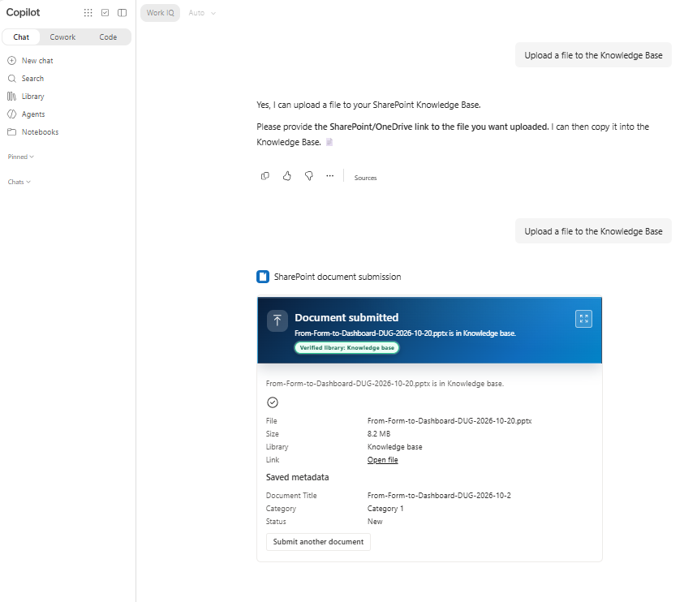
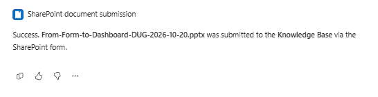
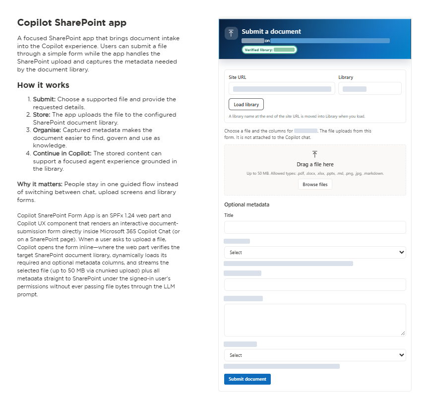

# SharePoint Document Submission Form

## Summary

**SharePoint Document Submission Form** (`copilot-sharepoint-form-app`) is an SPFx 1.24 Copilot UX component and modern SharePoint web part, packaged with a declarative agent, that submits a document (up to 50 MB) and its library metadata columns directly to a SharePoint document library. The SPFx component owns the file picker and streams bytes directly to SharePoint REST (`SPHttpClient`), so the file is never attached to a Copilot chat message and never passes through the LLM prompt.

When a user asks in Microsoft 365 Copilot chat to upload or submit a file (or regular Copilot Chat routes the request to the **SharePoint document submission** agent), the agent calls `OpenDocumentSubmissionForm` and renders the form inline:







The same React form is also exposed as a SharePoint web part (`CopilotSharePointFormWebPart`) that can be placed on any modern SharePoint page:



### Video walkthrough

[](https://www.youtube.com/watch?v=HNiq6eZ6itc)

[Watch the walkthrough on YouTube](https://www.youtube.com/watch?v=HNiq6eZ6itc)

## Compatibility


## Applies to

- [SharePoint Framework](https://learn.microsoft.com/sharepoint/dev/spfx/sharepoint-framework-overview)
- [Microsoft Copilot extensibility](https://learn.microsoft.com/microsoft-365-copilot/extensibility/)
- [Microsoft 365 tenant](https://learn.microsoft.com/sharepoint/dev/spfx/set-up-your-development-environment)

> Get your own free development tenant by subscribing to the [Microsoft 365 developer program](https://aka.ms/m365/devprogram)

## Contributors

- [Anand Vijayaragavan](https://github.com/anandragav)

## Version history

| Version | Date | Comments |
| ------- | ---- | -------- |
| 1.0 | October 24, 2026 | Initial release of Copilot SharePoint Form web part and Copilot UX component |
| 1.3.6 | October 28, 2026 | Align Teams (`1.29`), Declarative Agent (`v1.8`), and AI Plugin (`v2.4`) manifests with SPFx 1.24 schemas; add User Guide and Page Owner Guide conversation starters |
| 1.3.7 | October 28, 2026 | Security hardening: lock `siteUrl` overrides to HTTPS on the active SharePoint tenant origin and enforce `.pdf,.docx,.xlsx,.pptx,.md,.png,.jpg` extension allowlist |

## Prerequisites

- **Node.js** `>=22.14.0 <23.0.0` (or Node 24 / 26 per SPFx `1.24.0-rc.0` engines) and the **Heft** toolchain (`@rushstack/heft`).
- **SharePoint Online tenant** with a tenant App Catalog and permissions to deploy SPFx solutions and sync declarative agents to Teams (**Add to Teams**).
- **Microsoft 365 Copilot add-on license (USL) for Copilot Chat tool execution:**
  - The modern SharePoint page web part (`CopilotSharePointFormWebPart`) and declarative agent registration/prompt-only starters work for any SharePoint user with site access.
  - However, live `RemoteMCPServer` tool binding (`OpenDocumentSubmissionForm`) inside Microsoft 365 Copilot Chat and access to `/_layouts/15/copilotworkbench.aspx` require the signed-in user to have a **Microsoft 365 Copilot add-on license (USL)** assigned. Without the Copilot USL, MOS3 skips `RemoteMCPServer` tool resolution (`matchedFunctionCandidates: []`).
- **No Microsoft Graph admin consent required:** `config/package-solution.json` declares zero `webApiPermissionRequests`. All SharePoint REST calls run under the signed-in user's delegated session via `SPHttpClient`.

## Minimal Path to Awesome

- Clone this repository (or [download this solution as a .ZIP file](https://pnp.github.io/download-partial/?url=https://github.com/pnp/spfx-copilot-components/tree/main/samples/copilot-sharepoint-form-app) then unzip it)
- From your command line, change your current directory to the directory containing this sample (`copilot-sharepoint-form-app`, located under `samples`)
- In the command line run:
  - `npm install`
  - `npm run build`
- In the **SharePoint Admin Center**, open **More features** → **Apps** → **Manage apps**:
  1. Select **Upload** and choose `sharepoint/solution/copilot-sharepoint-form-app.sppkg`.
  2. In **Enable app**, select **Enable this app and add it to all sites** (required so the Copilot UX component is available across sites), then select **Enable app**.
  3. Select **Copilot SharePoint Form App** in the app list and click **Add to Teams** in the toolbar to publish the bundled declarative agent (`ClientSideAssets/copilot-sharepoint-form-app.zip`).
- Open **Microsoft 365 Copilot** (`https://m365.cloud.microsoft/chat`):
  1. Select **SharePoint document submission** under **Agents** (or ask regular Copilot Chat to upload a file to a SharePoint library and accept its suggestion to hand off to **SharePoint document submission**).
  2. Click the **Upload a file to the Knowledge Base** conversation starter (or ask *"Upload a file to the Documents library"*).
  3. Approve the one-time **Allow** prompt on the first tool call. The interactive SPFx form renders inline in chat—verify or change the **Site URL** and **Library**, drop a file up to 50 MB, fill in the library's metadata columns, and click **Submit document**.
- To also embed the form on a SharePoint page, edit any modern SharePoint page, add the **Copilot SharePoint Form** web part, set the **Library name** in the property pane, and republish.

## Features

This sample illustrates the following concepts on SPFx `1.24.0-rc.0`:

- **Dual-host architecture (`BaseCopilotComponent` + `BaseClientSideWebPart`):**
  - `CopilotSharePointFormCopilotComponent` (`c7e4a1b8-2d56-4f90-9a33-1e8b6c5d4a27`) registers the `OpenDocumentSubmissionForm` tool in Microsoft 365 Copilot chat and updates `modelContext` when a submission completes so the agent can confirm the uploaded file name and target library.
  - `CopilotSharePointFormWebPart` (`3d7a624c-a1da-450a-a786-e3d5ff7cbf5b`) hosts the exact same React form on a modern SharePoint page with property pane configuration.
- **Direct-to-SharePoint file streaming (up to 50 MB, zero bytes in the LLM prompt):**
  - Files **up to 10 MB** upload in a single request via `/_api/web/GetFolderByServerRelativePath(decodedUrl='...')/Files/add(overwrite=true,url='...')`.
  - Files **over 10 MB and up to 50 MB** stream in 10 MB chunks using `StartUpload`, `ContinueUpload`, and `FinishUpload` with live progress reporting and `CancelUpload` cleanup on cancellation or failure.
- **Dynamic library verification and schema discovery:**
  - Queries `GET /_api/web/lists/getByTitle('...')?$select=Id,Title,BaseTemplate,RootFolder/ServerRelativeUrl&$expand=RootFolder` and verifies `BaseTemplate === 101` (Document Library) before enabling the file picker.
  - Queries `GET /_api/web/lists/getByTitle('...')/fields?$filter=Hidden eq false and ReadOnlyField eq false`, filters out system/internal columns, splits editable columns into **Required** and **Optional metadata**, and writes metadata after upload via `ValidateUpdateListItem` (`bNewDocumentUpdate: true`).
- **Security posture and input hardening:**
  - **Zero privilege escalation:** Runs with `isDomainIsolated: false` and no `webApiPermissionRequests`; SharePoint enforces all site, library, and item-level ACLs for the signed-in user.
  - **Same-tenant HTTPS `siteUrl` lock (`isUsableSiteUrl`):** Any `siteUrl` override passed by a user or tool call must use `https:`, contain no embedded credentials, target a SharePoint Online host (`.sharepoint.com`, `.sharepoint.us`, `.sharepoint.de`, `.sharepoint.cn`), and match the active SharePoint tenant origin (`window.location.origin` / `pageContext.web.absoluteUrl`). Cross-tenant or external URLs are rejected before any network call is made.
  - **Strict file extension allowlist (`DEFAULT_ALLOWED_EXTENSIONS`):** Allowed extensions default to and are intersected against `.pdf,.docx,.xlsx,.pptx,.md,.png,.jpg` (`.md` and `.markdown` alias each other). Active or executable file types (such as `.html`, `.aspx`, `.svg`, or `.exe`) are always blocked even if passed in a custom configuration.
  - **OData and filename sanitization:** Escapes single quotes via `odataString()`, strips directory paths via `baseFileName()`, and rejects illegal SharePoint filename characters (`["#%*:<>?/\|]`) and 0-byte files.
- **Graceful demo mode in local workbench:**
  - When running in the local workbench (`npm run start`) or when no live SharePoint context is available, the form enters **demo mode** with sample columns (`Document Title`, `Department`, `Document Category`, `Effective Date`, `Confidential`, `Notes`) and simulated chunked progress while clearly indicating that nothing is written to SharePoint. Real HTTP `403` permission errors remain visible and never fall back to demo mode.

## Architecture

```
copilot/                         Declarative agent manifests bundled into the .sppkg
  manifest.json                  Teams app manifest (v1.29) registering the declarative agent
  declarativeAgent.json          Declarative agent (v1.8) with instructions & conversation starters
  ai-plugin.json                 Plugin manifest (v2.4) bound to OpenDocumentSubmissionForm
  instruction.txt                Agent instructions enforcing immediate tool call & no fake cards
config/
  copilot-agent.json             Points copilotAgentPlugin at the Copilot UX component (static discovery)
  package-solution.json          SPFx solution packaging configuration (1.3.7.0)
src/
  copilotComponents/copilotSharePointForm/
    CopilotSharePointFormCopilotComponent.ts            BaseCopilotComponent host for Copilot chat
    CopilotSharePointFormCopilotComponentProperties.ts  Zod tool parameter schema
  webparts/copilotSharePointForm/
    CopilotSharePointFormWebPart.ts                     SPFx web part host for modern pages
    components/                                         Fluent UI v9 React form
    logic/                                              Validation, upload plan, field mapping, URL escaping
    services/                                           SharePointFormSubmissionService & chunked REST upload
```

## Web part & tool properties

| Property | Default | Purpose |
| --- | --- | --- |
| `siteUrl` | Current SharePoint site | Optional HTTPS SharePoint site URL on the same tenant origin |
| `libraryName` / `libraryTitle` | `Documents` | Target SharePoint document library (`BaseTemplate === 101`) |
| `maxFileSizeMb` | `50` | Maximum file size in MB (1 to 50) |
| `allowedExtensions` | `.pdf,.docx,.xlsx,.pptx,.md,.png,.jpg` | Comma-separated subset of the supported allowlist |
| `overwriteExisting` | `true` | Passed to `Files/add(overwrite=...)` |
| `formColumnsJson` | `""` (auto-discover from library) | Optional JSON array of `{ internalName, label, type, required, choices }` |

## Testing & validation

Run the unit test suite (61 tests across 16 suites covering validation, same-tenant HTTPS origin enforcement, extension allowlist intersection, direct and chunked upload, `CancelUpload`, schema filtering, `ValidateUpdateListItem`, and React UI flows):

```bash
npx heft test --clean --production
```

Build the production solution and agent package:

```bash
npm run build
```

## Troubleshooting

| What you see | Why | What helps |
| --- | --- | --- |
| Conversation starters 2 and 3 answer in chat, but upload requests do not invoke `OpenDocumentSubmissionForm` (`matchedFunctionCandidates: []` in `-developer on` debug info) | The signed-in account does not have a Microsoft 365 Copilot add-on license (USL), so MOS3 skips `RemoteMCPServer` tool resolution | Test with a user account assigned a Microsoft 365 Copilot add-on license |
| **Add to Teams** fails with HTTP 409 (`SyncSolutionToTeams`) after editing `copilot/` files | Teams rejects an equal or lower manifest version | Bump `version` in both `copilot/manifest.json` and `config/package-solution.json` before running `npm run build` |
| The card stays on a loading skeleton right after deploying a new `.sppkg` | SharePoint CDN/service worker is still serving the previous manifest map | Wait a few minutes, unregister the SharePoint service worker in browser DevTools → Application → Service Workers, and hard-reload Copilot (`Ctrl+Shift+R` / `Cmd+Shift+R`) |

## Help

We do not support samples, but this community is always willing to help, and we want to improve these samples. We use GitHub to track issues, which makes it easy for community members to volunteer their time and help resolve issues.

You can try looking at [issues related to this sample](https://github.com/pnp/spfx-copilot-components/issues?q=copilot-sharepoint-form-app) to see if anybody else is having the same issues.

If you encounter any issues using this sample, [create a new issue](https://github.com/pnp/spfx-copilot-components/issues/new).

## Disclaimer

**THIS CODE IS PROVIDED _AS IS_ WITHOUT WARRANTY OF ANY KIND, EITHER EXPRESS OR IMPLIED, INCLUDING ANY IMPLIED WARRANTIES OF FITNESS FOR A PARTICULAR PURPOSE, MERCHANTABILITY, OR NON-INFRINGEMENT.**


