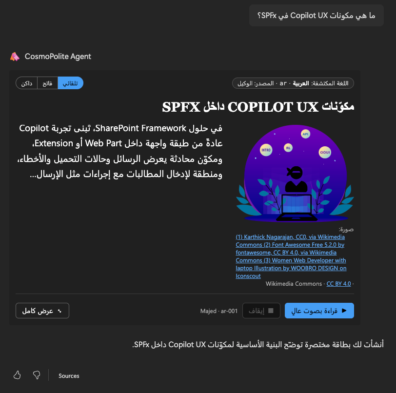
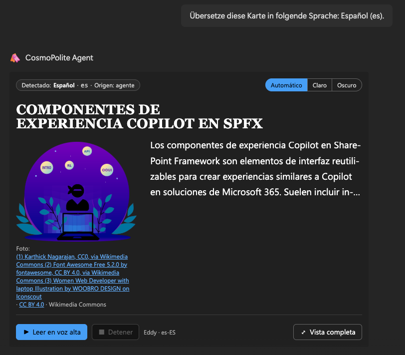
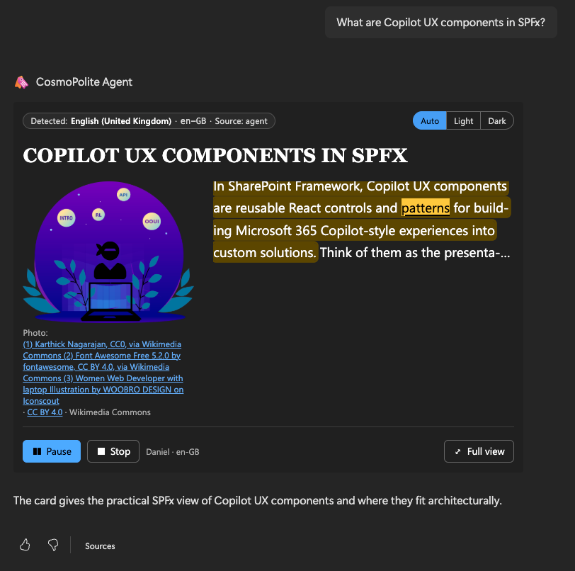
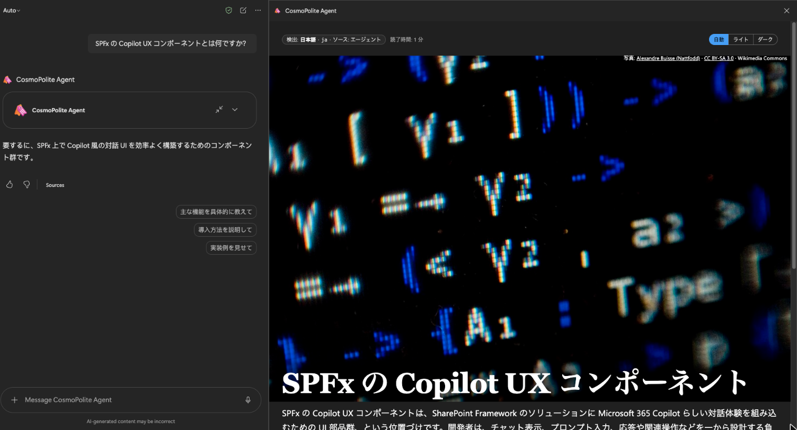
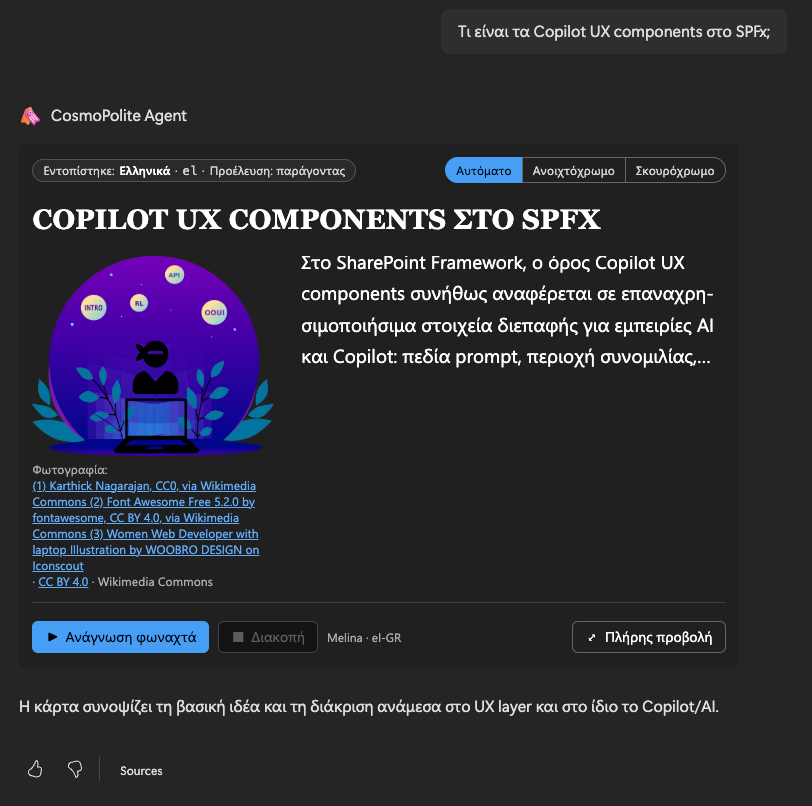

# CosmoPolite - multilingual story card

## Summary

CosmoPolite is a multilingual SPFx Copilot UX component, packaged with a declarative agent, that answers in the language you ask in. Ask "Erzähl mir etwas über Wien", "Verzell mer öppis über Züri" or "أخبرني شيئًا عن القاهرة", and the agent replies with a story card: a short text written in that language or dialect, a photo from open collections with its credit, a layout like a news article, and a **Read aloud** button that reads the story with a voice for that language.

Everything on the card follows the story's language: the labels, the reading direction (Arabic, Hebrew, Persian and Urdu run right to left), the fonts, the voice, and the `lang` attribute of the frame, so screen readers pronounce the text correctly. The component has no framework dependency and calls no Microsoft Graph API.











## Compatibility


## Applies to

- [SharePoint Framework](https://learn.microsoft.com/sharepoint/dev/spfx/sharepoint-framework-overview)
- [Microsoft Copilot extensibility](https://learn.microsoft.com/microsoft-365-copilot/extensibility/)
- [Microsoft 365 tenant](https://learn.microsoft.com/sharepoint/dev/spfx/set-up-your-development-environment)

> Get your own free development tenant by subscribing to the [Microsoft 365 developer program](https://aka.ms/m365/devprogram)

## Contributors

- [Stefan Bauer](https://github.com/StfBauer)

## Version history

| Version | Date             | Comments        |
| ------- | ---------------- | --------------- |
| 1.1     | October 29, 2026 | Upgrade to SPFx 1.24.0 |
| 1.0     | October 18, 2026 | Initial release |

## Prerequisites

- A Microsoft 365 tenant with SPFx 1.24 Copilot Components available, and Microsoft 365 Copilot licences for the users.
- A tenant app catalog, and the rights to upload a custom agent (Teams app) in your tenant.
- No API permissions to approve: the component calls no Microsoft Graph or SharePoint API.
- The browser must be allowed to reach the open image collections listed under [Privacy and external services](#privacy-and-external-services). If they are blocked, the card shows the story without a photo.

## Minimal path to awesome

- Clone this repository (or [download this solution as a .ZIP file](https://pnp.github.io/download-partial/?url=https://github.com/pnp/spfx-copilot-components/tree/main/samples/multilingual-story-card) then unzip it)
- From your command line, change your current directory to the directory containing this sample (`multilingual-story-card`, located under `samples`)
- In the command line run:
  - `npm install`
  - `npm run build`
- Upload `sharepoint/solution/CosmoPolite.sppkg` to the tenant app catalog and select **Deploy**. The package contains both the component and the agent (`ClientSideAssets/cosmopolite-agent.zip`), so one upload is enough; `teams/cosmopolite-agent.zip` is the same agent on its own, for tenants that upload agents separately.
- Open Microsoft 365 Copilot, select the **CosmoPolite** agent, and use one of its conversation starters, or ask about any place, person or topic in any language.

To work on the component with the Copilot workbench, run `npm run start`.

When you redeploy:

1. Bump both versions in `config/package-solution.json` (otherwise the upload fails with a 409).
2. If anything in `copilot/` changed (instructions, starters, icons), also bump `version` in `copilot/manifest.json` (three parts, e.g. `1.0.20`).
3. Run `npm run build` and upload the new `.sppkg`.
4. Reload Copilot (Cmd/Ctrl+Shift+R) and start a new chat: the client caches the agent's version and conversation starters, and SharePoint takes a few minutes to spread a new package (see [Troubleshooting](#troubleshooting)).

### Sample prompts

The agent's conversation starters ask the same question in four languages and scripts:

- `Tell me something about Copilot Components.` (English)
- `Erzähl mir etwas über Copilot Components.` (German)
- `أخبرني شيئًا عن Copilot Components.` (Arabic, right to left, with a left-to-right product name inside)
- `Copilot Components について教えて。` (Japanese)

More to try:

- `Erzähl mir etwas über Wien.` (German)
- `Erzö ma wos über Wean.` (Viennese dialect)
- `Verzell mer öppis über Züri.` (Swiss German)
- `Kerro minulle jotain Helsingistä.` (Finnish)
- `أخبرني شيئًا عن القاهرة.` (Arabic, right to left)
- `Translate this into Japanese.` (switches the card, its labels, voice and follow-ups to Japanese)
- `Show it in the magazine design with the photo on top.`
- `Show me the diagnostics.` (opens the diagnostics drawer described below)

## Features

The agent detects the language of every message (as a BCP 47 tag, dialects included) and calls the `CosmoPoliteTool` with a headline, 80 to 120 words written in that language, English keywords for the photo, and optional look settings. The card renders it inline in the chat; **Fullscreen** opens a magazine-like reading view.

This sample illustrates the following concepts:

- **Language follows the content.** The card checks the agent's language tag against the text it actually received, reconciles both, and labels the card with the result ("Erkannt: Deutsch (Österreich) · de-AT · Quelle: Agent"). UI labels exist for 58 languages: all 47 Microsoft 365 Copilot work/school languages plus Austrian German, Swiss Standard German, Swiss German (Schwiizerdütsch), Urdu and seven African languages (Amharic, Swahili, Afrikaans, Zulu, Yoruba, Hausa, Somali). English is bundled; the others are lazy-loaded chunks.
- **`lang` and `dir` everywhere.** Every part of the card carries its language and direction. Inside Copilot the component's frame is its own document, and SharePoint sets `<html lang>` from the *user's* setting (`culture=`), not from what the frame shows. The card claims `<html lang/dir>` for the story's language (WCAG 3.1.1) and restores the host value when it's disposed. Latin names inside right-to-left text stay left-to-right islands.
- **Right-to-left and script-aware typography.** Arabic, Hebrew, Persian and Urdu run right to left with the layout mirrored; Urdu uses a Nastaliq font; letter-spacing is switched off for connected scripts.
- **Read aloud with the Web Speech API.** The card picks a voice for the exact language tag, then for the language, preferring the natural "Online" voices. Dialects without voices of their own fall back to their standard language (Swiss German to `de-CH`). The sentence being spoken is marked, and the current word is highlighted with the CSS Custom Highlight API where the voice reports word boundaries. The voice is named next to the buttons ("Katja · de-DE", the full name on hover) and follows Edge when its better online voices arrive. If no voice for the language exists in the current host, the buttons are hidden and a short note says so, instead of reading the text with a wrong-language voice.
- **Photos from open collections.** When the story is about a member of the [Microsoft 365 & Power Platform community team](https://pnp.github.io/#team), the card shows their own portrait from pnp.github.io (a bundled list of the 60 names, refreshed with `npm run update-pnp-team`; the name is matched on the device, nothing is looked up). Otherwise the image search tries Wikipedia (by article), Wikimedia Commons, Openverse, The Metropolitan Museum of Art and NASA, filters irrelevant results, accepts only allowlisted image hosts, and shows the author and licence under the photo.
- **Look and layout.** Five design presets, three photo layouts, and light, dark or **Auto** (following Copilot), switchable on the card or by asking the agent. See [Designs, layouts and themes](#designs-layouts-and-themes).
- **Conversation.** **Translate** asks the agent for the same story in another language, and the agent then answers and suggests follow-ups in that language. The card updates the model context, so the next turn knows what's on screen.
- **One scrollbar, one look while loading.** The component hides SharePoint's generic loading skeleton and shows its own, and lets the frame grow with the card so Copilot's panel is the only scroller.
- **Accessibility.** Live-region announcements in the card's language, visible focus, reduced motion, forced colours and higher contrast are respected; `npm run check-contrast` checks every text/background token pair against WCAG in light and dark.
- **Atomic design without a framework.** The UI is built from plain DOM factories in `src/ui` (atoms, molecules, organisms, a card template) with CSS Modules and design tokens.

### Languages

The story itself can be in any language the model writes; the agent passes its BCP 47 tag, dialects included. The card's own labels (buttons, credits, notes) exist in the 58 languages below; for any other tag they match the closest table (`de-LI` → `de`), and for a language without a table they use the user's Copilot or SharePoint language, then English. Which read-aloud voices exist depends on the browser and operating system, not on this list (see [Limitations](#limitations)).

| Language | Own name | Tag | Reviewed |
| --- | --- | --- | --- |
| Afrikaans | Afrikaans | `af` |  |
| Albanian | shqip | `sq` |  |
| Amharic | አማርኛ | `am` |  |
| Arabic | العربية | `ar` |  |
| Austrian German | Österreichisches Deutsch | `de-AT` | ✓ |
| Brazilian Portuguese | português (Brasil) | `pt-BR` |  |
| Bulgarian | български | `bg` |  |
| Canadian French | français canadien | `fr-CA` |  |
| Catalan | català | `ca` |  |
| Croatian | hrvatski | `hr` |  |
| Czech | čeština | `cs` |  |
| Danish | dansk | `da` |  |
| Dutch | Nederlands | `nl` |  |
| English | English | `en` | ✓ |
| Estonian | eesti | `et` |  |
| European Portuguese | português europeu | `pt-PT` |  |
| Filipino | Filipino | `fil` |  |
| Finnish | suomi | `fi` |  |
| French | français | `fr` |  |
| German | Deutsch | `de` | ✓ |
| Greek | Ελληνικά | `el` |  |
| Hausa | Hausa | `ha` |  |
| Hebrew | עברית | `he` |  |
| Hungarian | magyar | `hu` |  |
| Icelandic | íslenska | `is` |  |
| Indonesian | Indonesia | `id` |  |
| Italian | italiano | `it` |  |
| Japanese | 日本語 | `ja` |  |
| Korean | 한국어 | `ko` |  |
| Latvian | latviešu | `lv` |  |
| Lithuanian | lietuvių | `lt` |  |
| Malay | Melayu | `ms` |  |
| Maltese | Malti | `mt` |  |
| Mexican Spanish | español de México | `es-MX` |  |
| Norwegian Bokmål | norsk bokmål | `nb` |  |
| Polish | polski | `pl` |  |
| Romanian | română | `ro` |  |
| Russian | русский | `ru` |  |
| Serbian (Cyrillic) | српски (ћирилица) | `sr-Cyrl` |  |
| Serbian (Latin) | srpski (latinica) | `sr-Latn` |  |
| Simplified Chinese | 简体中文 | `zh-Hans` |  |
| Slovak | slovenčina | `sk` |  |
| Slovenian | slovenščina | `sl` |  |
| Somali | Soomaali | `so` |  |
| Spanish | español | `es` |  |
| Swahili | Kiswahili | `sw` |  |
| Swedish | svenska | `sv` | ✓ |
| Swiss German | Schwiizerdütsch | `gsw` | ✓ |
| Swiss High German | Schweizer Hochdeutsch | `de-CH` | ✓ |
| Thai | ไทย | `th` |  |
| Traditional Chinese | 繁體中文 | `zh-Hant` |  |
| Turkish | Türkçe | `tr` |  |
| Ukrainian | українська | `uk` |  |
| Urdu | اردو | `ur` |  |
| Vietnamese | Tiếng Việt | `vi` |  |
| Welsh | Cymraeg | `cy` |  |
| Yoruba | Èdè Yorùbá | `yo` |  |
| Zulu | isiZulu | `zu` |  |

### Designs, layouts and themes

**Theme.** A three-way switch at the top of every card: **Auto**, **Light** and **Dark**. **Auto** (the default) follows Copilot's theme and changes with it; **Light** and **Dark** hold regardless of Copilot. The page behind the card and the scrollbar colour follow too, so there are no light gaps around a dark card.

**Design and layout.** In fullscreen, **Look** opens the two other switches:

| Design | Character |
| --- | --- |
| Editorial | Serif headline over a sans-serif text, perfect-fourth type scale |
| Classic | Serif throughout, golden-ratio scale, generous leading |
| Dramatic (default) | Heavy uppercase headline, perfect-fifth scale |
| Compact | Small steps and a tight rhythm, for a lot of text in little space |
| Magazine | Image-led: full-bleed photo with the headline on a scrim |

| Layout | Photo position |
| --- | --- |
| Lead image | Big photo above the headline |
| Teaser | Small photo beside the headline |
| Side image (default) | The text wraps around the photo |

Designs change type, spacing and fonts, never colours, so every design works in light and dark and keeps its WCAG contrast. Where SharePoint Brand Center fonts are available, the designs use them.

You can also ask for a look in the chat ("show it in the magazine design with the photo on top"); the agent passes `design` and `layout` with the next card. The precedence is fixed: what you switch on a card wins, then what you asked for in this turn, then your last choice on any card, then the default. Your choice is remembered in the browser and handed to the model as context, so the next card keeps the look without asking again. Switching only changes attributes on the card, so focus, scroll position and read-aloud carry on.

### Read aloud: where it works best

Read aloud uses the speech engine of whatever runs Copilot, so the voices differ by browser, operating system and app. The card never reads a story with a voice of another language: if no voice for the story's language exists, the buttons are hidden and a short note says so. The voice it picked is named next to the buttons ("Katja · de-DE").

| Where Copilot runs | Voices | What to expect |
| --- | --- | --- |
| **Microsoft Edge** (Windows, macOS) | System voices plus Microsoft's "Online (Natural)" voices | **Best experience.** Natural voices for most languages, including regional ones such as Austrian German (Ingrid, Jonas) and Swiss German (Leni, Jan), and the current word is highlighted while reading. The online voices send the text being read to Microsoft's speech service. |
| **Google Chrome** | System voices plus a few Google voices for major languages | Works for widely spoken languages; fewer regional voices, and word highlighting depends on the voice. |
| **Safari, Firefox** | The operating system's voices only | Works for the languages installed on the device. |
| **Microsoft 365 Copilot app on Windows** | None offered to the component in our tests | The read-aloud buttons stay hidden. |
| **Copilot on phones and tablets** | Not tested | |

Tips for more and better voices:

- **Use Microsoft Edge** for demos: it has by far the most languages and the most natural voices.
- **Windows:** add speech for more languages under **Settings** > **Time & language** > **Language & region** (language options, speech).
- **macOS:** add voices under **System Settings** > **Accessibility** > **Spoken Content** > **System voice** > **Manage Voices**. Then reload Copilot.
- **Dialects** use their standard language's voice when they have none of their own: Swiss German (`gsw`) reads with a Swiss Standard German (`de-CH`) voice, Bavarian and Viennese with an Austrian one, falling back to German (`de-DE`) when no regional voice is installed.
- **Edge's "Multilingual" voices** (for example "Seraphina Mehrsprachig") are listed under one language but detect the language of the text themselves. The card may pick one when it is listed under the story's language; it then reads that language natively.

### Accessibility

The card is built against WCAG 2.2 AA. Covered, with something in the code or the build that backs it:

| Criterion | How |
| --- | --- |
| 3.1.1 Language of Page | The frame's `<html lang/dir>` follows the story, not the user's SharePoint setting; restored when the card goes away |
| 3.1.2 Language of Parts | `lang` and `dir` on every part; each language name in the translate list in its own language; Latin names inside right-to-left text marked left-to-right |
| 1.4.3 / 1.4.11 Contrast | `npm run check-contrast` checks every text/background token pair (4.5:1) and the focus ring (3:1) in light and dark on every build |
| 2.1.1 Keyboard, 2.4.3 Focus Order, 2.4.7 Focus Visible | Native buttons, radio groups and select only; logical order; visible focus ring (checked by keyboard in Copilot); Escape stops reading |
| 1.3.1, 4.1.2 | Headline is a heading, switches are radio groups with a legend, icon-only buttons have a name |
| 4.1.3 Status Messages | Reading, pausing and "no voice" are announced in a polite live region, in the card's language |
| 1.4.2 Audio Control | Speech only starts on request; pause, stop and Escape |
| 2.5.8 Target Size | Buttons at least 32 px (44 px on touch screens) |
| 1.4.10 Reflow | Container queries; checked down to 380 px wide |

Also respected: reduced motion, forced colours (Windows high contrast), higher contrast and reduced transparency.

Known gaps, not yet fixed:

- **Magazine headline on light photos:** the dark band behind the headline fades out too early; the tops of tall letters can sit on about 2.6:1 (large text needs 3:1).
- **Alt text** describes the photo the agent asked for. When the search returns a different picture, the alt text doesn't match it.
- **Not yet tested:** text spacing (1.4.12), and screen readers (NVDA, JAWS, VoiceOver) inside Copilot.

### The tool contract

The agent calls `CosmoPoliteTool` once per message. The schema lives in `CosmoPoliteCopilotComponentProperties.ts` (zod, turned into the tool's JSON schema at build time); every description there is an instruction to the model. The card checks every argument again at runtime (`lib/normalize.ts`) and ignores what doesn't fit.

| Parameter | Required | Limit | What it is |
| --- | --- | --- | --- |
| `language` | yes | BCP 47 tag | Language of the user's latest message, dialects included (`de-AT`, `gsw`). For a translation, the target language. |
| `title` | yes | 120 characters | Headline, **in that language** |
| `text` | yes | 1,200 characters | 80 to 120 words, plain text, **in that language** (in the dialect, if the user wrote in one) |
| `imageQuery` | yes | 100 characters | 2 to 4 **English** keywords describing something photographable; a person's full name first. Never acronyms or product code names. |
| `imageSource` | no | `wikipedia`, `museum`, `space`, `photo` | Which collection to try first (see below) |
| `wikipediaTitle` | no | 200 characters | Exact title of the English Wikipedia article about the subject; its lead image is tried first |
| `imageAlt` | no | 200 characters | Description of the expected photo, **in that language** |
| `design` | no | `editorial`, `classic`, `dramatic`, `compact`, `magazine` | Only when the user asks for a look |
| `layout` | no | `lead`, `teaser`, `beside` | Only when the user asks where the photo goes |
| `voice` | no | `female`, `male` or a voice name | Only when the user asks for a voice |
| `debug` | no | `true` | Opens the diagnostics drawer |

Order of the photo search: a member of the [community team](https://pnp.github.io/#team) named in the keywords gets their own portrait first. Then the Wikipedia article named in `wikipediaTitle`. Then keyword searches: The Met first for `museum`, NASA first for `space`, Openverse (Wikimedia Commons only) first for `photo`, otherwise Wikipedia; Wikimedia Commons is always last. Every Commons result passes the safety filter described under [Limitations](#limitations).

Everything the agent sends travels in the address of the component's page (see [Troubleshooting](#troubleshooting)), so the limits are kept deliberately small.

### Diagnostics

Ask the agent for diagnostics and it sets `debug: true` on the tool call. The card then shows a drawer with what the agent sent, the language decisions, the image search trace, the available voices, sizes and the host context. Useful when a card looks wrong in one host but not in another.

### Demo: wrong `lang`, wrong voice

`demo/lang-mismatch/index.html` is a standalone page (open it in Edge or Chrome, no build needed) that shows why the `lang` attribute matters. It has German text marked `lang="en"` and English text marked `lang="de"`, with the same read-aloud buttons and voice choice as the card. Press **Read aloud**, then **Fix lang**, and listen again. An option allows Edge's "Multilingual" voices, which detect the language themselves and hide the mistake. Screen readers and most other voices can't do that. The photo is Rocco Morabito's "The Kiss of Life" (1967), public domain, via [Wikimedia Commons](https://commons.wikimedia.org/wiki/File:Kiss_of_Life_by_Rocco_Morabito.jpg).

### Privacy and external services

The component runs no server of its own and uses no analytics. At runtime the browser contacts:

- **Image collections:** `en.wikipedia.org`, `commons.wikimedia.org`, `api.openverse.org`, `collectionapi.metmuseum.org` and `images-api.nasa.gov` with English keywords for the photo, and loads the photo from their image servers (`upload.wikimedia.org`, `thumb.wikimedia.org`, `images.metmuseum.org`, `images-assets.nasa.gov`). For a member of the community team, the portrait comes from `pnp.github.io`. These services see the user's IP address and the keywords.
- **Speech:** the browser's own speech engine. In Microsoft Edge the "Online (Natural)" voices send the text being read to Microsoft's speech service.

The chosen look is stored in the browser's local and session storage. See [PRIVACY.md](PRIVACY.md) and [TERMS.md](TERMS.md).

### Limitations

- **Voices depend on the host.** See [Read aloud: where it works best](#read-aloud-where-it-works-best). In testing, the Microsoft 365 Copilot app on Windows offered no voices to the component, so the read-aloud buttons stay hidden there.
- **Photos are found live.** Results depend on the open collections and can occasionally miss the subject. The card then shows the next candidate or no photo. Wikimedia Commons has no safe search, so every Commons and Openverse result is checked by its title, categories and tags (`lib/images/safety.ts`): special-effects make-up, injuries, gore, nudity and similar subjects are never shown. The filter errs on the side of caution, so a harmless photo is occasionally skipped. Flickr is not used: its photos (via Openverse) were too often of low quality.
- **Long non-Latin stories can fail to load.** Copilot passes the tool arguments to the component in the page URL, where non-Latin text grows six to nine times when encoded. When SharePoint's sign-in then takes an extra round trip, the request can fail with a 401 and the card stays blank. Reported as [SharePoint/sp-dev-docs#11064](https://github.com/SharePoint/sp-dev-docs/issues/11064); retrying usually works.
- **The agent ships a fixed tool list** (`"toolDiscovery": "static"` in `config/copilot-agent.json`). With SPFx's default dynamic discovery, Copilot only fetched the tool from SharePoint during the conversation, and the first message of a new chat often got a plain-text answer instead of a card. The fixed list makes the card work from the first message; after changing the tool's parameters, rebuild and upload the agent package again. SPFx describes static mode as a temporary fallback, so check it again with newer SPFx versions.
- **Suggested follow-ups follow the request, not always the card.** The instruction asks for follow-ups in the language of the latest card, but after a translation Copilot often suggests them in the language the request was written in (a German request for a Spanish card gets German suggestions). Copilot generates these suggestions itself.
- **Translations of the labels.** Only the English, German, Austrian German, Swiss Standard German, Swiss German and Swedish label tables were reviewed by a person; the others were machine-written and are flagged as unreviewed in the diagnostics. Corrections by native speakers are welcome.

## Troubleshooting

| What you see | Why | What helps |
| --- | --- | --- |
| The first message of a new chat gets a plain-text answer, no card; the second message works | SPFx's default dynamic tool discovery fetches the tool from SharePoint during the conversation, and on the first turn it often isn't there yet | This sample ships a fixed tool list (`"toolDiscovery": "static"` in `config/copilot-agent.json`). If you remove it, send the message again. |
| The card stays blank right after you uploaded a new version; the console shows `SPFx manifest map is not loaded` | SharePoint is still spreading the new package to its caches | Wait 10 to 15 minutes, then reload Copilot (Cmd/Ctrl+Shift+R) |
| A long card in Arabic, Thai, Greek or another non-Latin script stays blank; the console shows `spserviceworker.js` errors and a 401 on `Authenticate.aspx` or `PortableComponent.aspx` | Copilot passes the tool arguments in the page address. Non-Latin text grows six to nine times when encoded, and a sign-in renewal wraps the address once more ([SharePoint/sp-dev-docs#11064](https://github.com/SharePoint/sp-dev-docs/issues/11064)) | Send the message again; shorter stories load more reliably |
| Old conversation starters, or Copilot's general start page under the agent's input box | The client cached the previous agent | Reload with Cmd/Ctrl+Shift+R, or open the agent in a new tab; it can take a few minutes after an update |
| No read-aloud buttons, only a note | No voice for the story's language on this device or in this app | See [Read aloud: where it works best](#read-aloud-where-it-works-best) |
| A photo that doesn't fit the story | The open collections found nothing better for the keywords | Ask for the card again, or name the subject more concretely ("St. Stephen's Cathedral" rather than "church") |

For anything else, ask the agent for diagnostics: the drawer shows what the agent sent, every step of the photo search, the voices, the frame size and the language decisions.

## Lessons for Copilot component developers

What building this sample taught us, beyond multilingual cards:

- **`render()` runs far more often than its name suggests:** on the first paint, on every `host-context-changed` (theme, display mode and every container size change) and on every tool result. Make it cheap. This component builds its DOM once and later only switches data attributes; CSS does the rest.
- **An inline card's height must never shrink when the card gets narrower.** Copilot's widget frame shows a scrollbar for a moment while it catches up with the card; that takes 15 px of width. If the card then gets shorter (fluid `vw` type, photos sized by a percentage or an aspect ratio), the scrollbar goes away, the card grows again, and the card and Copilot resize each other endlessly: thousands of `host-context-changed` messages and a flickering scrollbar. Here, fluid sizes ignore width changes smaller than 24 px (`stabilizeFluidWidth`), and inline photos have fixed caps.
- **Never set `min-height: 100%` on the document.** Copilot sizes the frame to the document; with a minimum of 100 % the frame can grow but never shrink again.
- **Pass parameters, not generated content.** The other samples pass IDs, dates and search terms and fetch their data themselves. Model-written text in the tool arguments travels through the page address and can break with non-Latin scripts (see Troubleshooting).
- **Pin the tool catalog** (`"toolDiscovery": "static"`) if your component has to work on the first message of a chat.
- **Set `<html lang>` to the content's language.** SharePoint sets it from the user's setting, which is wrong for a frame that shows nothing but your content.
- **Image search needs a safety filter.** Wikimedia Commons has no safe search, and acronyms like "SPFx" mean something else there.

## Solution structure

| Command | What it does |
| --- | --- |
| `npm run build` | Contrast check, Heft build and lint, Vitest tests, type-check of the tests, then the production `.sppkg` in `sharepoint/solution/` and the agent package in `teams/` |
| `npm test` | Heft build and lint, Vitest tests, type-check of the tests |
| `npm run test:watch` | Vitest in watch mode (run `npm test` once first: the stylesheet tests read Heft's compiled CSS) |
| `npm run check-contrast` | WCAG contrast of all text/background token pairs, light and dark |
| `npm run preview` | Static preview pages in `temp/preview/index.html` (scenarios across languages, themes, modes and presets, rendered through the real component lifecycle) and the pattern catalog in `temp/preview/catalog/index.html` (every piece of `src/ui` in light/dark × LTR/RTL) |
| `npm run start` | `heft start` with the Copilot workbench |
| `npm run update-pnp-team` | Refreshes the bundled list of community team members from [pnp.github.io](https://pnp.github.io/#team) (`lib/images/sources/pnpTeam.data.ts`) |

```
src/ui/                         shared UI, no framework: factories createX(props) → element (+ update)
  tokens/                       colour tokens and design presets
  atoms/ molecules/ organisms/  button, chip, note … radioGroup, voiceControls … figure, story, footer, devPanel
  templates/card.ts             places the pieces by [data-part]; data-mode / -layout / -design / -theme on the root
src/copilotComponents/CosmoPolite/
  CosmoPoliteCopilotComponent.ts            lifecycle, state, composition of src/ui
  CosmoPoliteCopilotComponentProperties.ts  tool contract (zod → JSON schema at build time)
  lib/strings/         UI string tables (58 languages)
  lib/detect.ts        detects the language the text is really in and reconciles it with the agent's tag
  lib/language.ts      fallback chain, display names, text direction, segmentation
  lib/images/          image search: sources, allowlist, relevance filter, fallbacks
  lib/voiceover.ts     read-aloud controller; lib/speech.ts voice choice and sentence player
  lib/hostDocument.ts  what the card sets on the frame's <html>/<body>
  lib/diagnostics.ts   diagnostics drawer (its own chunk)
  testing/             Vitest setup, preview harness, pattern catalog
copilot/               agent manifest, instructions, conversation starters, icons
demo/lang-mismatch/    the "wrong lang, wrong voice" demo page
scripts/check-contrast.mjs
```

The DOM is built once per card. Inline ↔ fullscreen, light/dark, layout and design only change data attributes on the root; grid areas and container queries do the rest, so focus, scroll position and read-aloud survive a switch. If Copilot replaces the frame anyway, the choices come back from session storage.

## Help

We do not support samples, but this community is always willing to help, and we want to improve these samples. We use GitHub to track issues, which makes it easy for community members to volunteer their time and help resolve issues.

You can try looking at [issues related to this sample](https://github.com/pnp/spfx-copilot-components/issues?q=multilingual-story-card) to see if anybody else is having the same issues.

If you encounter any issues using this sample, [create a new issue](https://github.com/pnp/spfx-copilot-components/issues/new).

## Disclaimer

**THIS CODE IS PROVIDED _AS IS_ WITHOUT WARRANTY OF ANY KIND, EITHER EXPRESS OR IMPLIED, INCLUDING ANY IMPLIED WARRANTIES OF FITNESS FOR A PARTICULAR PURPOSE, MERCHANTABILITY, OR NON-INFRINGEMENT.**


