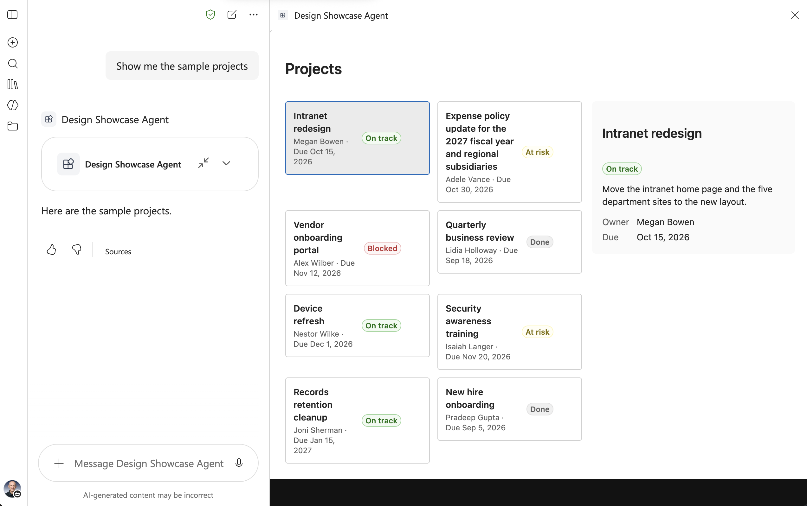
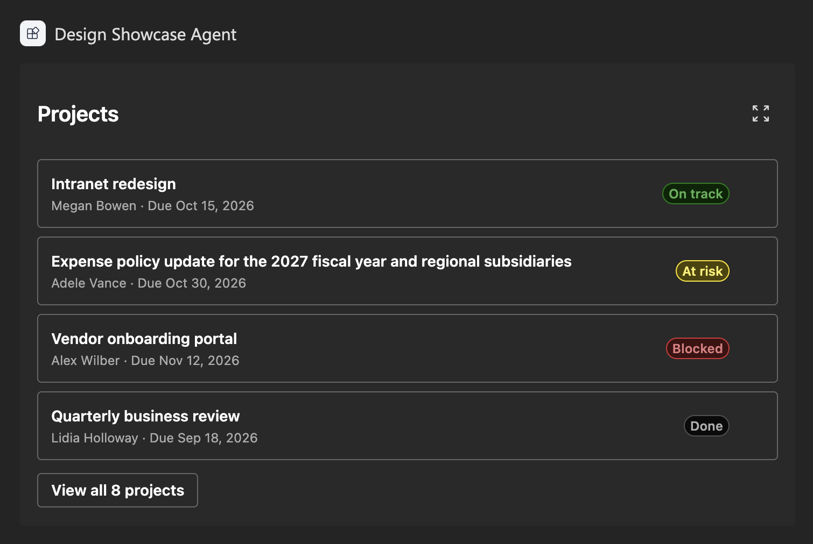
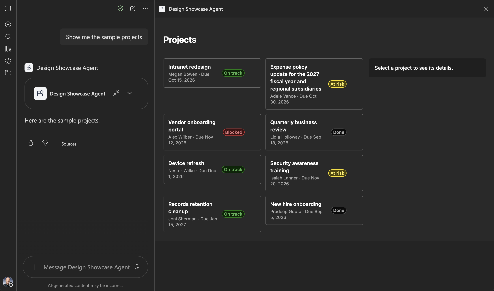

# Theme and design for the Copilot canvas

## Summary

This sample is the finished solution for the article [Theme and design for the Copilot canvas](https://learn.microsoft.com/sharepoint/dev/spfx/copilot/theme-and-design). Its Copilot UX component shows sample project cards that follow the Copilot light and dark themes and adapt to the inline and fullscreen display modes.

## Compatibility

## Applies to

- [SharePoint Framework](https://learn.microsoft.com/sharepoint/dev/spfx/sharepoint-framework-overview)
- [Microsoft Copilot extensibility](https://learn.microsoft.com/microsoft-365-copilot/extensibility/)
- [Microsoft 365 tenant](https://learn.microsoft.com/sharepoint/dev/spfx/set-up-your-development-environment)

> Get your own free development tenant by subscribing to the [Microsoft 365 developer program](https://aka.ms/m365/devprogram)

## Contributors

- [Andrew Connell](https://github.com/andrewconnell)

## Version history

| Version | Date             | Comments        |
| ------- | ---------------- | --------------- |
| 1.0     | October 11, 2026 | Initial release |

## Prerequisites

- The Node.js version in the `engines` field of `package.json`
- Permission to deploy to the tenant app catalog

## Minimal path to awesome

- Clone this repository (or [download this solution as a .ZIP file](https://pnp.github.io/download-partial/?url=https://github.com/pnp/spfx-copilot-components/tree/main/samples/tutorial-theme-and-design) then unzip it)
- From your command line, change your current directory to the directory containing this sample (`tutorial-theme-and-design`, located under `samples`)
- In the command line run:
  - `npm install`
  - `npx heft start --nobrowser`
- Go to the Copilot Workbench at `https://<tenant>.sharepoint.com/_layouts/15/copilotworkbench.aspx` and accept the loading of debug manifests.

To deploy the sample to Microsoft 365 Copilot:

- In the command line run `npm run build`.
- Upload `sharepoint/solution/tutorial-theme-and-design.sppkg` to the tenant app catalog and select **Enable app**.
- In the app catalog, select the app and select **Add to Teams**.
- In Microsoft 365 Copilot, find the agent and add it. A new agent can take some time to appear; signing out and in again can help.

## Features

The solution contains one declarative agent and one Copilot UX component:

| Component | Tool | Display modes |
| --- | --- | --- |
| `DesignShowcase` | `ShowDesignShowcase` | `inline`, `fullscreen` |

In the inline display mode, the component shows the first four projects in a single column, with a button to open all the projects in the fullscreen display mode. The colors come from the Copilot theme, so the same component works in the light and dark themes.

In the fullscreen display mode, the component shows all the projects in a grid with a details pane for the selected project.

The component shows bundled sample data. It makes no network calls and requests no API permissions. The solution package is the only thing to deploy.

This sample illustrates the following concepts:

- following the Copilot light and dark themes with Fluent UI
- adapting the layout to the inline and fullscreen display modes and to the width of the canvas
- keeping the selection when the display mode changes
- a tool with no parameters

## Help

We do not support samples, but this community is always willing to help, and we want to improve these samples. We use GitHub to track issues, which makes it easy for community members to volunteer their time and help resolve issues.

You can try looking at [issues related to this sample](https://github.com/pnp/spfx-copilot-components/issues) to see if anybody else is having the same issues.

If you encounter any issues using this sample, [create a new issue](https://github.com/pnp/spfx-copilot-components/issues/new).

## Disclaimer

**THIS CODE IS PROVIDED _AS IS_ WITHOUT WARRANTY OF ANY KIND, EITHER EXPRESS OR IMPLIED, INCLUDING ANY IMPLIED WARRANTIES OF FITNESS FOR A PARTICULAR PURPOSE, MERCHANTABILITY, OR NON-INFRINGEMENT.**

