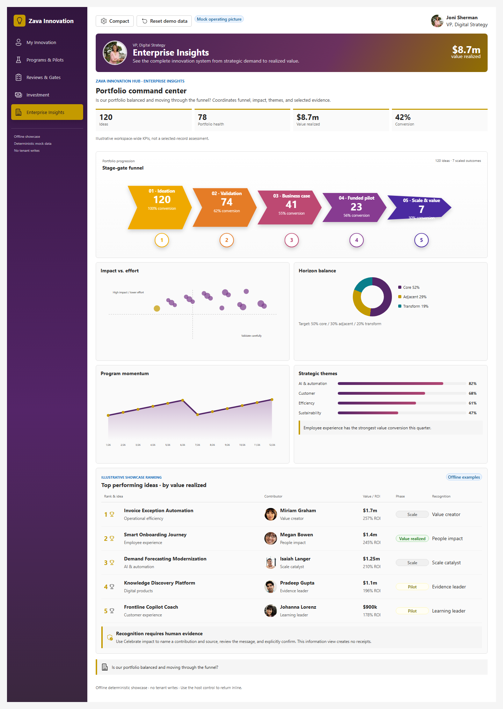
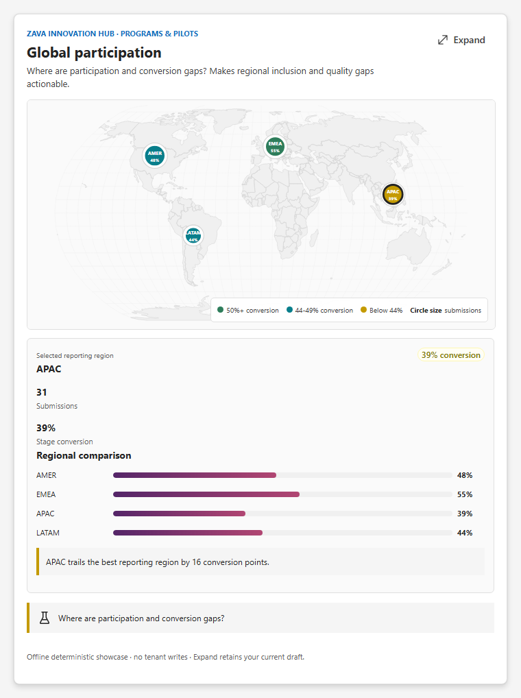
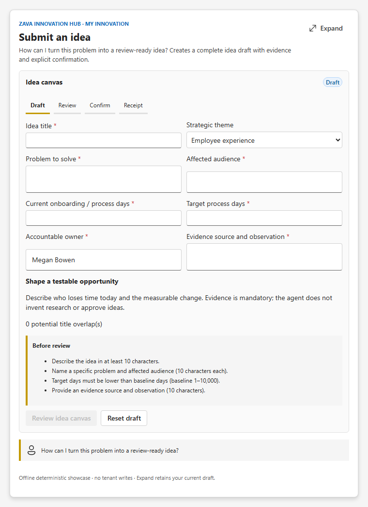
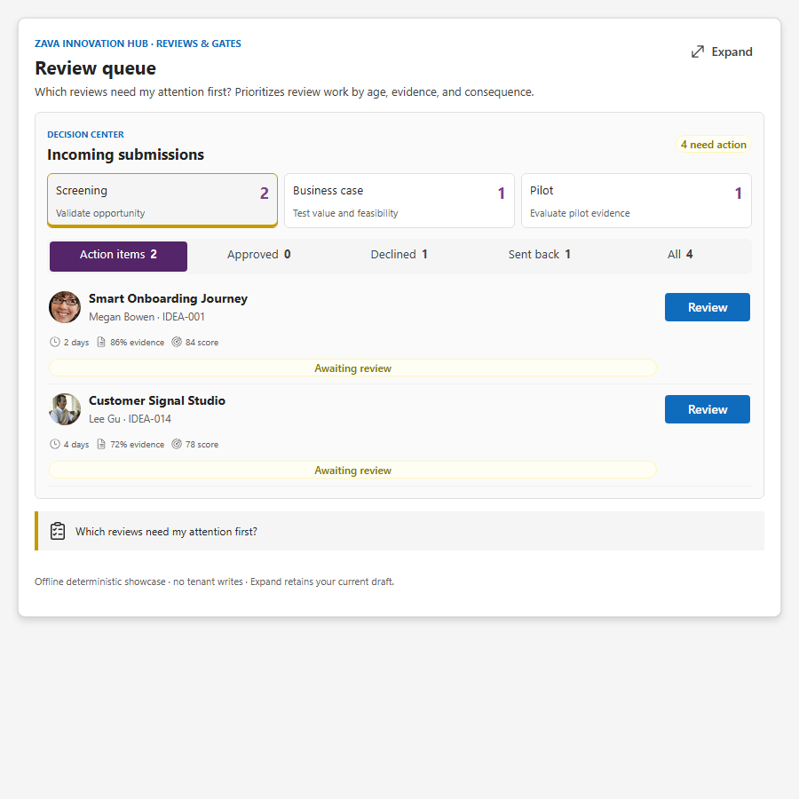

# Zava Innovation Hub — Copilot Components

> **SPFx 1.24.0 GA upgrade (October 28, 2026):** Build dependencies target GA.
> React/ReactDOM use 18.3.1. Earlier readiness reports, screenshots, test counts,
> and tenant evidence remain historical, not fresh GA host certification.
> Restore was validated using the configured Microsoft npm proxy; npmjs.org did not yet expose
> all required GA packages. Use an approved registry with 1.24.0 available; do not commit credentials.

An offline innovation-management showcase with **17 registered tools**, one shared SPFx bundle,
five role workspaces, and intent-specific inline experiences. Copilot selects the business job;
controlled React UX owns evidence, calculations, validation, review, and explicit human confirmation.

**Runtime:** SPFx **1.24.0**, React/ReactDOM **18.3.1**, React types **18.3.31/18.3.7**,
Heft **1.3.2**. Node.js 22.14+ within 22.x, 24.x, or 26.x is supported by the manifest;
this release was validated with Node **22.23.2**. Preserve the pinned versions and `fast-uri` 3.1.8 override.

> No live tenant data, automated approvals, messaging, capital transfers, or persistent workflow.
> Receipts are in memory until page reload or **Reset demo data**. They do not rewrite the immutable
> source catalog or update other dashboards. A pilot **Go** is learning, never scale authorization.
> Earlier August design/rehearsal artifacts describe a previous implementation and are historical only.

## Screenshots

| Enterprise Insights | Global participation |
| --- | --- |
|  |  |

| Idea submission | Inspection-only review queue |
| --- | --- |
|  |  |

The 11 curated publication filenames and thumbnail metadata are retained. Supplementary captures
in [`assets/intent-evidence.json`](assets/intent-evidence.json) cover every tool at standard,
narrow, and dark settings; all seven submission flows have review/receipt evidence in each variant.
[`assets/gallery-evidence.json`](assets/gallery-evidence.json) and the supplementary report include
current source hashes, image hashes, dimensions, runtime errors, and overflow checks.

## The seven complete business operations

Every flow follows **Draft → Review → Confirm → semantic session receipt**. Review is a snapshot of
the actual controlled inputs, not an invented readiness score. **Edit draft** returns to the same inputs;
reset restores the invocation defaults. No receipt exists before the final confirmation.

| Tool | Distinct work, evidence, and safeguards |
| --- | --- |
| `SubmitInnovationIdea` | Problem, affected audience, strategic theme, owner, evidence source, current/target process days. Target must improve baseline. Review calculates reduction and checks exact title overlap against the 120-idea catalog. This is not a semantic/live duplicate check. |
| `BuildIdeaBusinessCase` | Selected idea, investment, annual gross benefit, annual cost, benefit confidence, owner, and sourced assumption. Review calculates net benefit, confidence-adjusted net, first-year ROI, and adjusted payback. Non-positive adjusted benefit explicitly has no payback. No NPV or multi-year cash flow is claimed. |
| `CelebrateInnovationImpact` | Selected measured outcome, named contributor, specific contribution, measurement source, recognition channel, and editable message. Review composes the actual praise with the selected idea's measured amount. Confirmation prepares a story; it does not post it. |
| `ReviewInnovationFunding` | Gate eligibility, Approve/Adjust/Defer/Decline choice, requested USD amount, accountable owner, and conditions. Review shows available-before, new commitment, and remaining envelope. Allocation cannot exceed $800,000 or bypass the selected idea's gate; defer/decline commit $0. |
| `GenerateInnovationBrief` | Selected idea or complete catalog source ledger, audience, owner, headline, editable evidence narrative, and leadership decision ask. Source totals remain independent of narrative edits. Confirmation prepares a brief; there is no fake Send/Export action. |
| `LaunchInnovationChallenge` | Recruitment theme/region/audience, opening/closing dates, qualified submission target, owner, measurable success criteria, and impact/feasibility/inclusion weights. Requires a 7–90-day window, whole target 1–1,000, and a 100% rubric. Confirmation stages a mock launch. |
| `ManageInnovationExperiment` | Funded pilot, hypothesis, predeclared sample and reduction thresholds, baseline/observed process days, sample size, incident count, observation source, owner, and separate human Go/Pivot/Stop choice. Rules explain their recommendation. Insufficient sample or missed reduction blocks Go; any safety incident requires Stop. Confirmation records learning only. |

Business-case formulas:

- Annual net = annual benefit − annual operating cost.
- Adjusted net = benefit × confidence / 100 − annual operating cost.
- First-year ROI = (annual net − one-time investment) / investment × 100.
- Adjusted payback = investment / adjusted annual net × 12, only if adjusted net is positive.

All money is USD. Mandatory long text is at least 10 characters; financial values are finite and
bounded at runtime. Exported schemas deliberately avoid unsupported JSON Schema length/range keywords.
User-entered evidence is not independently verified.

## All 17 intent contracts

Only implemented parameters are advertised. Fixed analytical snapshots intentionally accept no filters.
Unknown explicit IDs, unsupported regions, or empty personal/value filter results remain visibly
**no-match**, publish no-match model context, and never fall back to another record or a healthy score.

| Tool | Optional properties | Actual behavior / scope |
| --- | --- | --- |
| `SubmitInnovationIdea` | `message`, `theme` | Initializes title and theme; complete opportunity intake as above. |
| `GetMyInnovation` | `ideaId`, `theme` | Filters ideas owned by the signed-in display name. Shows stage, impact, effort, and stage-specific next action; first 12 matches, with count. |
| `BuildIdeaBusinessCase` | `ideaId`, `amount` | Initializes the selected record and one-time investment. |
| `CelebrateInnovationImpact` | `ideaId`, `message` | Initializes selected outcome and editable recognition text. |
| `GetInnovationReviewQueue` | None | Screening/Business case/Pilot buckets and status filters change the actual visible records/counts. Detail inspection cannot commit decisions. |
| `ReviewIdeaGate` | `ideaId` | Exact selected gate record; inspect strengths/gaps, choose approve/send back/decline, enter rationale, review consequences, explicitly confirm. Only this tool owns gate decisions. |
| `ReviewInnovationFunding` | `ideaId`, `amount`, `message` | Initializes selected request, proposed capital, and editable rationale; capital constraints apply. |
| `ExploreInnovationPortfolio` | None | Curated illustrative horizontal funnel, impact/effort bubbles, investment mix, momentum, themes, and impact ranking. Read-only, not a generic filter workspace. |
| `TrackInnovationValue` | `ideaId`, `theme` | Selected-scope projected/measured totals and variance, with named owner ledger (first 8 matches). The separate trend is explicitly the whole program series. |
| `GenerateInnovationBrief` | `ideaId` | One idea or all 120 catalog records; sums the actual selected data. |
| `GetInnovationGrowth` | None | Fixed Jan–Dec 2026 series; submissions/conversion/value buttons change the chart and computed first-to-last change. |
| `ExploreGlobalInnovation` | `region` | Actual selected AMER/EMEA/APAC/LATAM marker and regional evidence; comparison gap is calculated from selection. |
| `TrackInnovationBudget` | None | Fixed mock bridge: $4.8m allocated − $2.6m committed − $900k spent − $500k forecast = $800k available. |
| `GetInnovationPortfolioHealth` | None | Illustrative leadership scorecard and exceptions, separate from exploratory portfolio charts. Not a live computed assessment. |
| `LaunchInnovationChallenge` | `message`, `theme`, `region` | Initializes title/theme/recruitment region. |
| `ManageInnovationExperiment` | `ideaId`, `message` | Initializes funded pilot and editable hypothesis; observations must be supplied by a person. |
| `ExploreAgentCapabilities` | `query` | Search all 16 operational capabilities and select a safe scenario/prompt preview. It never invokes or confirms an operation. |

Default record is `IDEA-001` where a single idea is needed, except funding (`IDEA-044`, gate-approved) and
experiment (`IDEA-057`). Those defaults apply **only when no ID was supplied**.

### Exact demonstration records

| ID | Name | Useful route |
| --- | --- | --- |
| `IDEA-001` | Smart Onboarding Journey | Screening gate, business case, recognition |
| `IDEA-014` | Customer Signal Studio | Screening review with data-owner/privacy gaps |
| `IDEA-022` | Supplier Carbon Twin | Inspect sent-back review |
| `IDEA-026` | Meeting Mood Scanner | Inspect declined review |
| `IDEA-031` | Knowledge Discovery Platform | Pending business-case gate; capital allocation is blocked |
| `IDEA-044` | Demand Forecasting Modernization | Approved review history and value variance |
| `IDEA-057` | Frontline Copilot Coach | Pilot learning and pilot gate |
| `IDEA-063` | Invoice Exception Automation | Measured $1.7m outcome and recognition |

`domain.ts` contains 120 deterministic synthetic idea records, with these named overlays,
11 fictional demo personas, four regional aggregates, and 12 months of illustrative program history.
`REVIEW_SUBMISSIONS` is a separate curated queue with phase-specific evidence and historical outcomes.
The queue and aggregate funnel are demonstration snapshots, not inferred from the synthetic stage
distribution. There is no implied durable progression between tools.

## Full screen and lifecycle

The same mounted primary body continues inline and full screen: fields, selected record, step,
reviewed snapshot, and receipt survive passive width/theme/mode changes. A new component invocation or
changed intent/properties starts fresh. The retained React root is unmounted before awaited base teardown.

Role workspace defaults:

| Demo profile | Work area | Default tool |
| --- | --- | --- |
| Megan Bowen | My Innovation | Personal ideas |
| Johanna Lorenz | Programs & Pilots | Growth series |
| Diego Siciliani | Reviews & Gates | Inspection queue |
| Miriam Graham | Investment | Budget stewardship |
| Joni Sherman | Enterprise Insights | Portfolio command center |

Expand keeps the **invoked tool**, including a submission or selected-value view, rather than replacing
it with the area's default dashboard. Work-area navigation shows the other area's default. Returning to
the original area restores the retained primary body and its visible model context. Compact changes
spacing; Reset demo data clears receipts and resets mounted drafts. Navigation is a responsive icon rail
with arrow-key support. Role names are demo context, **not authorization**.

The supported `copilotBridge.updateModelContextAsync` publishes committed visible information,
no-match, review/confirmation snapshots, or receipt details. Uncommitted field edits are not published.
Hidden primary drafts do not replace context for a visible secondary workspace. Host expansion/context
errors are visible instead of being treated as success.

## Conversation starters

[`config/conversation-starters.json`](config/conversation-starters.json) is canonical. Each starter
owns one registered primary tool; capability exploration remains exactly last.

| # | Title | Starter | Expected inline component |
| ---: | --- | --- | --- |
| 1 | Submit an idea | Submit an idea to reduce new-hire onboarding time by half. | `SubmitInnovationIdea` |
| 2 | Global innovation | Compare innovation participation and conversion across regions. | `ExploreGlobalInnovation` |
| 3 | Portfolio funnel | Show stage conversion in our innovation portfolio funnel. | `ExploreInnovationPortfolio` |
| 4 | Portfolio health | Show which innovation portfolio health measures are outside target. | `GetInnovationPortfolioHealth` |
| 5 | Approve an idea | Review Smart Onboarding Journey for gate approval. | `ReviewIdeaGate` |
| 6 | Explore capabilities | Explore what this agent can do. | `ExploreAgentCapabilities` |

The existing M365 declarative-agent JSON and `copilot/instruction.txt` retain one-tool routing,
neighbor exclusions, exact record extraction, and human confirmation boundaries.
All existing 17 GUIDs and tool names are preserved.

## Build, test, and evidence

```powershell
npm ci
npx playwright install chromium
npm run capture:visual
npx tsc --project scripts\visual-harness\tsconfig.json
npm run build
```

`npm run build` validates identities/starters, agent icons, media provenance, routing documentation,
current-source gallery evidence, production audit, and diff whitespace; runs production compilation,
lint, and all discovered Jest tests; packages the solution and agent; audits generated plugin schemas
and package bytes. The production audit must pass, not be bypassed.

The GA upgrade passed 64 Jest tests, compilation, lint, packaging, generated-plugin validation,
and package-output validation. The full `npm run build` command currently fails at the production
dependency audit on existing `fast-uri@3.1.8`, `zod@3.24.1`, and `zod-to-json-schema@3.24.1`
advisories. These findings still require a separately scoped dependency/schema migration;
the audit gate remains enabled.

DOM tests use `act` from React and one retained root per test host. Coverage includes each distinct
operation, measured thresholds, actual input-to-receipt values, no-match, information property effects,
human gate choices, fresh invocations, teardown, and theme/mode retention.

- Curated publication: `assets/gallery-evidence.json` (11 thumbnails).
- Supplementary full-intent coverage: `assets/intent-evidence.json` and `assets/intent-visuals/`.
- Package contents/hashes: `assets/release-evidence.json`.
- Exact local validation commands/results: `assets/local-validation.json`.
- Deployable solution: `sharepoint/solution/zava-innovation-portfolio.sppkg`.
- M365 package: `teams/zava-innovation-hub.zip`.

The harness supports `intent`, `mode=fullscreen`, `theme=dark`, `ideaId`, `message`, `amount`, `region`,
`strategicTheme`, and `query`. `test=1` exposes passive theme/mode controls and hidden context evidence.
It is a local development harness, never a production route.

## Demo guides and external gates

- [10-minute business demo](Zava-Innovation-10-Minute-Business-Demo.md)
- [5-minute technical demo](Zava-Innovation-5-Minute-Technical-Demo.md)
- [4-minute keynote](Zava-Innovation-4-Minute-Keynote.md)
- [Designer review](Zava-Innovation-Designer-Review.md)
- [Routing matrix](Zava-Innovation-Routing-Matrix.md)
- [Current completion checklist and historical plan](todo.md)

Portraits are packaged byte-identically from the established demo reference set; names and
case-sensitive paths are in `src/shared/media.ts` and `assets/asset-provenance.json`. Unknown names
use initials. No profile-photo request is made. The four original design-reference PNGs are not
implementation evidence. Public portrait redistribution rights still require approval.

Local deterministic/browser tests do not certify a Microsoft 365 tenant. GA tenant installation,
actual natural-language routing and extraction, host CSP/bridge support, iframe focus, screen readers,
and full accessibility rehearsal remain external release gates. Previous Workbench evidence must not
be presented as fresh GA proof. Production identity/permissions, live data, finance, notifications,
durable workflow, independent evidence verification, and media rights are intentionally outside this
offline sample.

## Version history

| Version | Date | Comments |
| --- | --- | --- |
| Unreleased | October 28, 2026 | Upgrade to SPFx 1.24.0 GA; React/ReactDOM 18.3.1 and Heft 1.3.2. |
| 1.0.1 | October 22, 2026 | Restore the sample-specific README view tracker required by gallery validation. |
| 1.0 | October 20, 2026 | SPFx 1.24 RC0 showcase and validation update. |


