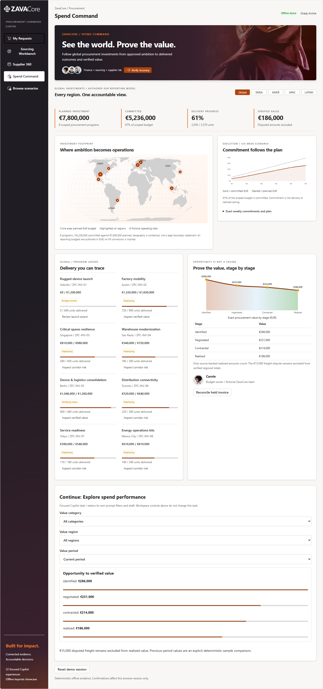
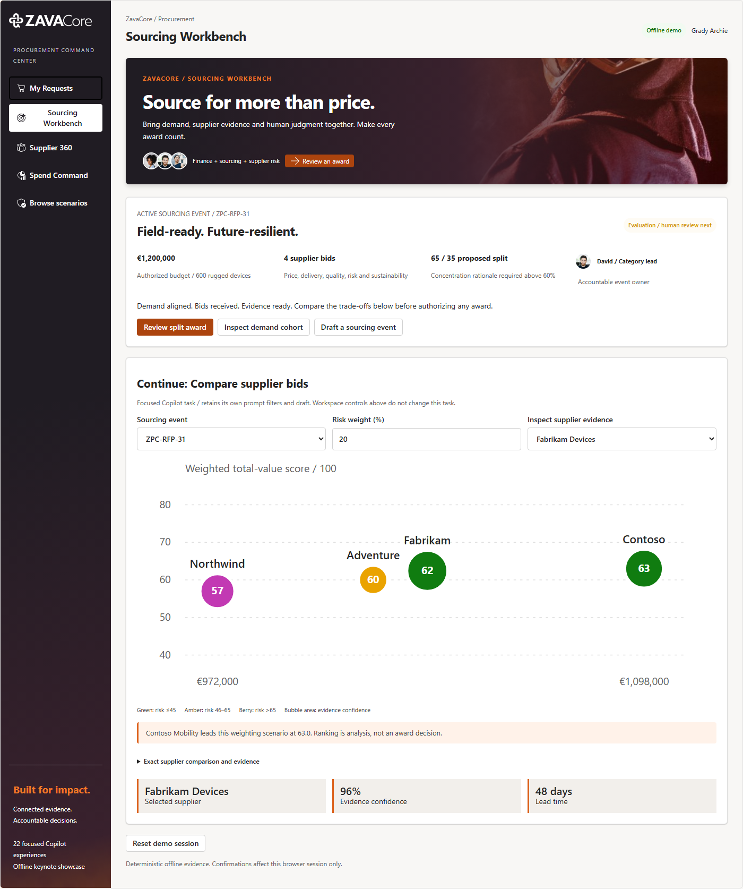
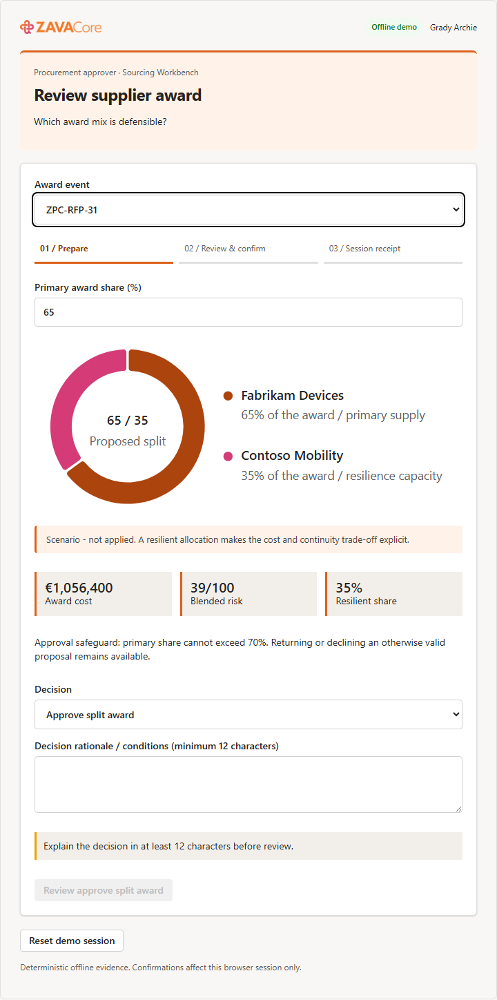
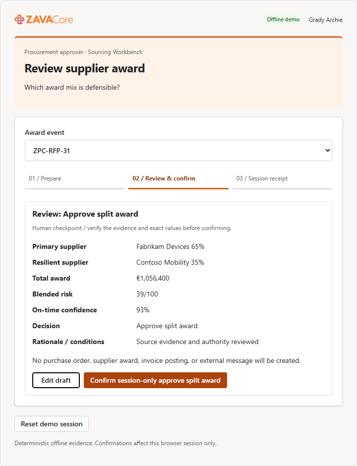
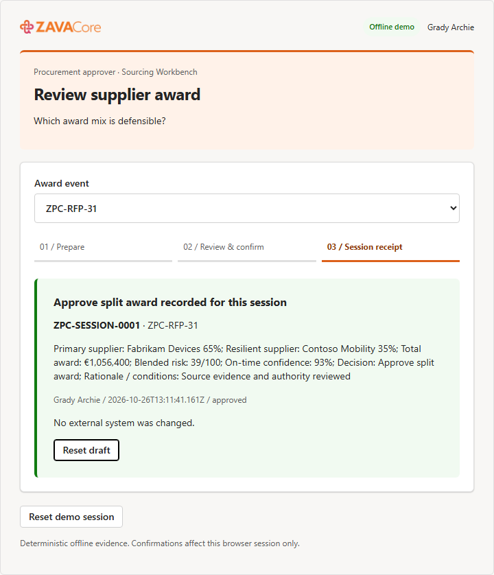

# ZavaCore Procurement Command Center

This release targets **SPFx 1.24.0-rc.0 with React 18.3.1**. Use Node.js 22 (22.14 or later), 24, or
26. See the [RC0 readiness report](../../RC0-updates.md) and
[canonical starter targets](config/conversation-starters.json).

> [!IMPORTANT]
> **Status: IMPLEMENTED OFFLINE SHOWCASE.** The solution contains 21 operational Copilot Components,
> one capability explorer, four connected full-screen workspaces, deterministic mock data, D3-derived
> decision visuals, visual evidence, and an audited deployable SharePoint package. Runtime actions are
> session-only demonstrations and never write to tenant or external systems.

> **Sample type:** self-contained, offline-first SPFx Copilot Components showcase<br>
> **Catalog:** 21 operational inline components + 1 capability explorer<br>
> **Full-screen model:** 4 role-aware lenses in one shared procurement application<br>
> **Reference quality bar:** [Zava Innovation Hub](../zava-innovation-portfolio/README.md) and its
> [agentic creation rules](../zava-innovation-portfolio/agentic-creation-rules.md)

## Screenshots

### Global investment command



### Sourcing Workbench



### Reviewed split award



### Explicit review and session receipt





Additional captured states cover every inline tool, My Requests, Supplier 360, Spend Command, bid
comparison, invoice reconciliation, 390 px mobile, and dark mode. Machine-readable hashes, layouts,
runtime, overflow, label, chart, and focus results are in
[assets/gallery-evidence.json](assets/gallery-evidence.json). Gallery publication metadata is in
[assets/sample.json](assets/sample.json).

## ZavaCore keynote experience

This modernization preserves all 22 generated component identities and the four-workspace topology.
The supplied **ZavaCore** logos, orange-to-magenta brand colors, field-operations photography and
named team portraits replace the earlier green identity, including the packaged agent and its icons.

- **My Requests:** outcome-led intake, explicit validation, exact-value review and confirmation,
  source-backed approval evidence, searchable status queues and a connected human-handoff timeline.
  A submitted business case becomes a real session record with its original currency, locations,
  constraints and quantity; its approval consumes that same record.
- **Sourcing Workbench:** curated `ZPC-RFP-31`, budget and award-readiness context, an interactive
  D3 supplier landscape, and a D3 split-allocation visual. Primary shares above 70% cannot be approved;
  returning a proposal for evidence remains available.
- **Supplier 360:** selected-supplier scorecard, owned continuity interventions, contract notice windows,
  qualification and renewal decisions. Missing contracts and unknown suppliers remain explicit.
- **Spend Command:** a bundled Natural Earth / Equal Earth world map, eight fictional operating sites,
  region-driven investment totals, commitment trends, unit-delivery progress and linked value evidence.
  The baseline is EUR 7.8m planned, EUR 5.236m committed, 2,050 / 3,370 units delivered and EUR 186k
  verified value. A confirmed **60/40** award changes the curated launch commitment to **EUR 1,059,600**
  and global commitments to **EUR 6,295,600**, without changing delivery or verified savings.

The fresh-intake approval journey and the seeded 600-device sourcing-to-value journey are separate
rehearsal slices. Approving a new request does not fabricate bids, attach it to the curated sourcing
event, create a purchase order or imply delivery. Global programs use authored **EUR reporting
budgets**; source request currencies are never silently aggregated or converted.

Confirmed actions survive reload in browser session storage. Drafts remain transient. If storage is
denied, the app explicitly announces the in-memory limitation. Reset clears the overlay and restores the
seeded records. Draft model context reports field presence/validation, not unreviewed business text.

The [approved design and worldwide capability benchmark](todo.md#workspace-purpose-and-competitive-benchmark)
draw on official Zip, Ivalua, GEP and JAGGAER product descriptions: guided intake, connected evidence,
supplier resilience, clear human authority and analytics that lead to action. This is a differentiated
offline Copilot UX showcase, not an enterprise-suite implementation or a vendor-ranking claim.

[Brand/geography provenance](assets/brand-provenance.json) records source and optimized hashes.
Natural Earth geography is public domain. Supplied ZavaCore artwork and portraits remain **pending
final publisher/redistribution approval**. No stock CDN, live geocoding or external data requests run
in the application.

The [keynote journey evidence](ux-review/evidence/zavacore-modernization.json) adds 24 checkpoints:
all four workspaces at 340, 760 and 1920 px, actual Chromium 200% page-scale emulation, invalid inputs,
edit/review/confirm, reload restoration, approval queues, authority limits, award-to-investment
consequences, regional geometry, keyboard map selection and Reset. Native browser zoom and
authenticated host accessibility remain separate checks.

## Implementation status

- 22 immutable Yeoman-generated component identities preserved through the RC0 upgrade and emitted
  in one shared React 18 bundle.
- Deterministic graph scale: 220 requesters, 14 categories, 600 requests, 90 suppliers, and 18 sourcing
  events centered on `ZPC-RFP-31` and invoice `ZPC-8831`.
- Fluent UI v9 and owner-document Griffel theming with distinct My Requests, Sourcing Workbench,
  Supplier 360, and Spend Command layouts in light, dark, desktop, and mobile states.
- Focused D3 scale/shape geometry for supplier total value and spend-to-value flow, with keyboard
  selection, accessible descriptions, visible legends, and exact table equivalents.
- Focused catalog, integrity, calculation, split-award, changed-geometry, and React root lifecycle tests.
- Eighty-four Playwright captures cover all 22 inline tools at standard light, 340 px light, and dark;
  four full-screen workspaces at desktop, mobile, and dark; plus six explicit review/receipt states.
  Runtime errors, overflow, labels, broken images, ownership, and focus are checked.
- Audited [zava-procurement-command-center.sppkg](sharepoint/solution/zava-procurement-command-center.sppkg):
  one shared JavaScript asset, one current agent ZIP, and 22 source tools discovered dynamically by MCP.
  Current package sizes and hashes are recorded in the [RC0 readiness report](../../RC0-updates.md).

Authenticated tenant validation remains required for Workbench CSP, iframe focus restoration,
screen-reader host behavior, actual model routing, and Copilot bridge behavior. Public redistribution
also requires final publisher and media-rights approval.

## RC0 purpose-specific workflows

The RC0 completion replaces the old generic working-note fallback. Each of the 22 owning React
components has a distinct business surface; no tool exposes the former shared 23-field schema.
Only the fields consumed by that intent are advertised, with descriptions and portable tool-schema
types. Runtime UX enforces numeric bounds and authority thresholds rather than exporting unsupported
v2.4 parameter constraints.
Unknown IDs remain visible no-match states rather than selecting another record.

- **Buying:** editable outcome intake; route/cost/deadline comparison; policy/remediation ledger;
  source-backed request decisions; before/after PO change with a source-bound authority cap.
- **Sourcing:** currency-coherent demand cohorts; scope/deadline/invitation drafts; weighted bid
  geometry and evidence; guarded split-award decisions.
- **Suppliers:** relationship/contract evidence; renewal decisions; continuity scenarios; evidence-
  attested intake; conditional qualification/expiry; owned mitigation triggers; give/get mandates.
- **Value:** addressable leakage; held invoice reconciliation; verified recovery decisions; filtered
  value-stage analysis; transparent device-supplier allocation scenarios.
- **Discovery:** searchable business scenarios and isolated previews that cannot confirm actions.

All 12 submit/review operations require Draft -> Review -> explicit confirmation -> a typed session
receipt. Decisions require at least 12 characters of rationale. Default draft inputs never execute an
action. Processed records remain marked in session; **Reset demo session** restores the invocation.
Edits survive passive theme/display changes, and opening a different task warns before discarding an
unconfirmed draft. Exact current test totals and archive hashes are in the
[RC0 readiness report](../../RC0-updates.md).

## Minimal path to awesome

1. Upload [sharepoint/solution/zava-procurement-command-center.sppkg](sharepoint/solution/zava-procurement-command-center.sppkg)
   to a SharePoint app catalog and deploy it tenant-wide.
2. Enable the packaged **ZavaCore Procurement Command Center** agent in the target Microsoft Copilot
   environment.
3. Start with: **“Compare the final rugged-device bids and show how risk changes the award.”**
4. Expand to Sourcing Workbench, change the risk weight, inspect the exact table, and open the reviewed
   65/35 award scenario.
5. Use Reset between rehearsals. All included data and confirmed actions are offline/session-only mocks.

## Build and validation

Use a supported Node.js version and run:

```bash
npm ci
npm run capture:visual
npm run check:keynote
npm run generate:assets
npm run build
```

`npm run build` validates the 22-tool catalog, runs clean tests, creates a production bundle and
`.sppkg`, validates the generated API plugin inside the current agent ZIP, and audits the package
archive. `npm run capture:visual` rebuilds the tenant-free harness and publication evidence.

## Demo and review assets

- [4-minute keynote](Zava-Procurement-4-Minute-Keynote.md)
- [10-minute business demo](Zava-Procurement-10-Minute-Business-Demo.md)
- [5-minute technical demo](Zava-Procurement-5-Minute-Technical-Demo.md)
- [Routing matrix](Zava-Procurement-Routing-Matrix.md)
- [Designer and rehearsal review](Zava-Procurement-Designer-Review.md)
- [PnP gallery metadata](assets/sample.json)
- [Asset provenance](assets/asset-provenance.json)

The scripts include setup, deterministic story values, expected tool routing, human checkpoints,
fallback screenshots, and explicit boundaries between local evidence and authenticated tenant proof.

## Business story

**An employee describes the business outcome, not a purchasing form. The agent assembles compliant
options and supplier evidence; procurement and budget owners compare consequences, govern exceptions,
and turn intent into an auditable commitment.**

Procurement joins demand, catalogs, policy, budgets, contracts, suppliers, bids, risk, sustainability,
approvals, purchase orders, receipts, and invoices. The sample demonstrates how agent UX reduces that
navigation while preserving controls:

1. A requester states the outcome, quantity, timing, location, budget, and constraints in Copilot.
2. Copilot selects a bounded intake, analysis, review, or action component.
3. Deterministic UX resolves catalog/contract/sourcing paths, calculates total value, explains policy,
   and exposes evidence and alternatives.
4. Requesters, buyers, risk owners, finance partners, and approvers edit assumptions and compare impact.
5. Purchase, sourcing, award, renewal, and invoice actions stop for review, authority, and confirmation.
6. Full screen continues from the exact request, cohort, supplier, event, scenario, or decision draft.
7. Session receipts update downstream demand, sourcing, supplier, spend, and value views.

The sample modernizes intake-to-pay and supplier decisions without claiming to replace ERP,
source-to-pay, contract, risk, or accounts-payable systems.

## Market-informed product position

Public source-to-pay platform baselines consistently span procurement strategy, guided intake, catalogs,
contracts, sourcing, supplier management, risk, buying, invoicing, spend visibility, policy, approvals,
and auditability. Current reference surfaces include
[SAP Spend Management](https://www.sap.com/products/spend-management.html),
[Coupa Procure-to-Pay](https://www.coupa.com/products/procure-to-pay/), and
[Microsoft Dynamics 365 procurement and sourcing](https://learn.microsoft.com/dynamics365/supply-chain/procurement/procurement-sourcing-overview).
Vendor performance claims are directional only and must not be presented as independent evidence.

| Traditional procurement pattern | Copilot Components modernization |
| --- | --- |
| Employees must know whether to use catalog, contract, purchase request, or sourcing. | The requester states the outcome; an intent-to-path component explains and initializes the compliant route. |
| Policy appears as a late rejection. | Every pass, warning, block, evidence need, threshold, and approver is visible while choices are still editable. |
| Bid evaluation hides complexity in a weighted spreadsheet. | Supplier value, risk, quality, delivery, sustainability, exceptions, and score sensitivity are interactive and inspectable. |
| Supplier risk is viewed separately from award and renewal. | Risk and dependency consequences appear in the current award, contract, and continuity decision. |
| Approval queues show amount and requester. | Review components show need, alternatives, budget, policy, supplier evidence, downstream commitment, and decision consequence. |
| Savings are declared at negotiation. | Leadership views distinguish identified, negotiated, contracted, and realized value with accountable evidence. |

Do not use Gartner branding, proprietary quadrant language, or unsupported market-leadership claims.
Industry expectations define lifecycle completeness; this sample proves the agent interaction model.

## Showcase objectives

| Objective | GA proof |
| --- | --- |
| Turn intent into a governed buying path | Request details dynamically select catalog, contract, reuse, sourcing, or exception paths with explainable policy. |
| Make total value more visible than unit price | Supplier comparison combines total cost, lead time, quality, risk, sustainability, terms, and service outcomes. |
| Put policy inside the decision | Rules show source, version, threshold, evidence, owner, remediation, and approval consequence before action. |
| Demonstrate cross-role handoffs | Requester demand becomes buyer sourcing, risk review, finance approval, supplier award, invoice resolution, and realized value. |
| Preserve human accountability | Sourcing launch, purchase approval, supplier award, renewal, and invoice disposition require explicit reviewed decisions. |
| Continue exact context | Expand retains request, cohort, criteria weights, supplier, scenario, evidence, and review step. |
| Deliver distinctive procurement UX | Intent path, total-value landscape, policy ledger, supply dependency map, and spend-to-value river are signature visuals. |

## End-to-end operating model

| Phase | Business job | Agentic experience | Owner |
| --- | --- | --- | --- |
| 1. Express need | Capture outcome and constraints without form hunting. | Natural language becomes a structured, reviewable purchase intent. | `CreatePurchaseIntentTool` |
| 2. Choose route | Find the fastest compliant fulfillment path. | Catalog, contract, reuse, supplier, source, and exception options compare transparently. | `CompareBuyingOptionsTool` |
| 3. Govern early | Understand policy before commitment. | Applicable rule, threshold, evidence, pass/warn/block, approver, and remediation are explainable. | `CheckPurchasePolicyTool` |
| 4. Approve demand | Decide whether need and route justify budget. | Need, alternatives, policy, budget, risk, and downstream commitment precede decision. | `ReviewPurchaseRequestTool` |
| 5. Shape demand | Combine fragmented requirements. | Similar requests form a reviewable cohort; savings and timing consequences are simulated. | `AggregateDemandTool` |
| 6. Source | Create a fair, controlled supplier event. | Requirements, weights, suppliers, timetable, safeguards, and review package form a draft event. | `BuildSourcingEventTool` |
| 7. Evaluate | Compare bids on total value. | Normalized bids respond visibly to criteria weights and sensitivity. | `CompareSupplierBidsTool` |
| 8. Award | Make an auditable supplier decision. | Score provenance, conflicts, risk, budget, alternatives, and award consequences precede confirmation. | `ReviewSupplierAwardTool` |
| 9. Understand supplier | Coordinate relationship, contracts, risk, and performance. | Supplier 360 connects spend, obligations, incidents, geography, dependency, and owners. | `ExploreSupplier360Tool` |
| 10. Renew or exit | Decide before notice deadlines. | Usage, value, benchmark, obligations, risk, alternatives, and negotiation scenarios support review. | `ReviewContractRenewalTool` |
| 11. Control spend | Find leakage and intervention value. | Off-contract, duplicate, fragmented, price variance, and maverick patterns tie to accountable actions. | `DetectSpendLeakageTool` |
| 12. Protect continuity | Understand supply risk and dependency. | Geographic, sub-tier, delivery, quality, cyber, financial, and compliance signals form scenarios. | `TrackSupplierRiskTool` |
| 13. Resolve exceptions | Reconcile invoice evidence and disposition. | PO, receipt, invoice, tax, quantity, price, and tolerance produce bounded reviewed actions. | `ResolveInvoiceExceptionTool` |
| 14. Realize value | Verify procurement impact. | Leaders connect savings stages, cycle time, compliance, risk, performance, and cash outcomes. | `ExploreSpendPerformanceTool` |

## Audiences and full-screen information architecture

| Lens | Primary persona | First useful state | Work and decisions |
| --- | --- | --- | --- |
| **My Requests** | Megan Bowen, regional operations lead | Active needs, recommended buying path, policy/evidence status, approvals, delivery promise, and next action. | Create/edit request, compare route, supply evidence, and track outcome. |
| **Sourcing Workbench** | Grady Archie, category manager | Demand cohorts, active sourcing events, supplier landscape, evaluation sensitivity, award readiness, and milestones. | Aggregate, create event, normalize/compare bids, investigate risk, and propose award. |
| **Supplier 360** | Nestor Wilke, supplier risk and contract lead | Relationship, contracts, spend, obligations, performance, incidents, geographic/sub-tier dependency, and reviews. | Monitor risk, prepare renewal, assign mitigation, and coordinate supplier action. |
| **Spend Command** | Miriam Graham, procurement finance leader | Spend-to-value river, compliance, cycle time, leakage, concentration, realized savings, cash impact, and accountable interventions. | Prioritize opportunities, inspect approval/award exposure, and verify value realization. |

**My Requests** is an outcome tracker, not a requisition list. **Sourcing Workbench** is the keynote
workspace with demand, criteria, supplier evaluation, risk, policy, and award in one coordinated view.
**Supplier 360** organizes obligations and dependencies around decisions rather than displaying a vendor
master record. **Spend Command** distinguishes identified opportunity from realized value and avoids an
equal-weight KPI-card dashboard.

## Inline component portfolio

Target: **21 operational components plus one safe capability explorer**. The larger count is justified
by distinct requester, buyer, category, supplier onboarding, risk, contract, finance, accounts-payable,
and executive jobs across source-to-pay and the supplier lifecycle.

| Model | Count | Contract |
| --- | ---: | --- |
| Information / interactive analysis | 8 | Immediate answer plus meaningful filtering, selection, comparison, simulation, or chart interaction. |
| Submit / create | 5 | Prompt-prefilled draft -> validation -> review -> confirmation -> session receipt. |
| Review / decision | 8 | Record/queue -> evidence and consequence -> decision draft -> confirmation -> receipt. |
| Education / discovery | 1 | Search/filter every operation and safely preview without confirming decisions. |

| # | Component | Model | Prompt properties | First useful inline state | Material interaction and action | Full-screen continuation |
| ---: | --- | --- | --- | --- | --- | --- |
| 1 | `CreatePurchaseIntentTool` | Submit | `outcome`, `categoryHint`, `quantity`, `neededBy`, `locations`, `budget`, `currency`, `constraints` | Outcome canvas with resolved category, scope, timing, budget, evidence gaps, route recommendation, and policy preview. | Editing need changes catalog/contract/reuse/source/exception route and required evidence. Review/confirm creates request receipt. | `my-requests/new`; preserves draft, route, evidence, validation, and step. |
| 2 | `CompareBuyingOptionsTool` | Information | `requestId`, `category`, `quantity`, `neededBy`, `priorityWeights`, `selectedOptionId` | Ranked catalog, contract, reuse, and source options with total cost, lead time, policy, risk, and sustainability. | Change priorities/quantity/date; ranking and consequences update with disclosed logic. Select route through reviewed action. | `my-requests/options`; preserves request, weights, option, and scenario. |
| 3 | `CheckPurchasePolicyTool` | Information | `requestId`, `category`, `amount`, `currency`, `region`, `supplierId`, `policyDate` | Explainable rule ledger with pass/warn/block, source/version, threshold, evidence, approver, owner, and remediation. | Change scenario and inspect rule source; add missing evidence or open owning request. No policy override here. | `my-requests/policy`; preserves request/scenario, rule selection, and evidence. |
| 4 | `ReviewPurchaseRequestTool` | Review | `requestId`, `proposedDecision`, `budgetOwnerId`, `conditionText` | Need, requester, options, budget impact, policy, risk, delivery consequence, approvers, and decision choices. | Approve/return/decline with conditions, authority, rationale, review, confirmation, and receipt. | `my-requests/review`; preserves request, evidence, conditions, and decision step. |
| 5 | `AggregateDemandTool` | Information | `category`, `period`, `regions`, `requestIds`, `similarityThreshold`, `selectedCohortId` | Similar-request cohort with organizations, timing, volume, spend, overlap, consolidation saving, and launch risk. | Threshold/cohort/date changes rebuild demand and savings/timing scenario; confirmed grouping creates session cohort. | `sourcing/demand`; preserves filters, threshold, cohort, and scenario. |
| 6 | `BuildSourcingEventTool` | Submit | `cohortId`, `category`, `requirements`, `criteria`, `supplierIds`, `openAt`, `closeAt` | Event studio with scope, requirements, weighted criteria, invited suppliers, schedule, safeguards, conflicts, and readiness. | Edit weights/requirements/suppliers/dates; validation checks total weights, fairness, conflicts, and evidence. Confirm creates draft event. | `sourcing/event-studio`; preserves event draft, section, validation, and step. |
| 7 | `CompareSupplierBidsTool` | Information | `eventId`, `supplierIds`, `criteriaWeights`, `currency`, `scenarioName`, `selectedSupplierId` | Normalized bid table and total-value landscape with price, total cost, lead time, quality, risk, sustainability, exceptions, and confidence. | Change weights and scenario; ranking, sensitivity, award mix, and exact values update. No award action. | `sourcing/evaluation`; preserves event, weights, suppliers, scenario, and selection. |
| 8 | `ReviewSupplierAwardTool` | Review | `eventId`, `supplierId`, `splitPercent`, `proposedDecision`, `conditionText` | Recommendation beside score provenance, bid exceptions, conflict checks, supplier risk, budget, alternatives, split scenario, and consequence. | Single/split/no-award/return choices recalculate spend, timing, concentration, and value. Decision requires rationale and confirmation. | `sourcing/award`; preserves event, supplier mix, evidence, conditions, and step. |
| 9 | `ExploreSupplier360Tool` | Information | `supplierId`, `period`, `region`, `category`, `dimension`, `selectedEventId` | Supplier relationship header plus contracts, spend, obligations, performance, incidents, risk, dependencies, owners, and timeline. | Period/dimension selection coordinates graph, exact evidence, obligations, and accountable owner. | `supplier-360/overview`; preserves supplier, filters, dimension, and event. |
| 10 | `ReviewContractRenewalTool` | Review | `contractId`, `scenario`, `termMonths`, `targetValue`, `proposedDecision`, `conditionText` | Notice clock, usage/value, obligations, performance, benchmark, supplier risk, alternatives, and negotiation scenarios. | Renew/renegotiate/consolidate/exit changes cost, continuity, leverage, approval, and timeline before confirmed decision. | `supplier-360/renewal`; preserves contract, scenario, assumptions, evidence, and decision. |
| 11 | `DetectSpendLeakageTool` | Information | `period`, `category`, `region`, `businessUnit`, `pattern`, `threshold`, `selectedOpportunityId` | Addressable leakage by off-contract, duplicate, fragmentation, price variance, and maverick pattern with evidence and owner. | Filters/threshold rebuild opportunities; selection shows exact transactions and intervention; assigning action is reviewed. | `spend-command/leakage`; preserves filters, pattern, threshold, and opportunity. |
| 12 | `TrackSupplierRiskTool` | Information | `supplierId`, `period`, `riskTypes`, `region`, `tier`, `scenario`, `selectedNodeId` | Risk scoreline plus geographic/sub-tier dependency graph, signals, trend, affected commitments, mitigations, and owners. | Change signal/scenario/tier; graph and exposure recalculate. Proposed mitigation requires review; no autonomous risk decision. | `supplier-360/risk`; preserves supplier, filters, scenario, node, and mitigation draft. |
| 13 | `ResolveInvoiceExceptionTool` | Review | `invoiceId`, `exceptionType`, `proposedDisposition`, `tolerance`, `note` | PO/receipt/invoice reconciliation with exact field differences, tax/currency, policy tolerance, supplier history, and cash consequence. | Accept within tolerance/request correction/hold/escalate requires authority, rationale, confirmation, and receipt. | `spend-command/invoice-exception`; preserves invoice, selected difference, evidence, and decision step. |
| 14 | `ExploreSpendPerformanceTool` | Information | `period`, `region`, `category`, `businessUnit`, `metric`, `valueStage`, `selectedDriverId` | Spend-to-value river plus cycle time, compliance, supplier performance, risk, cash, and accountable exceptions. | Filters and value stage rebuild visuals; selection traces exact opportunity to contract and realized evidence. | `spend-command/performance`; preserves filters, stage, metric, visual mode, and driver. |
| 15 | `OnboardSupplierTool` | Submit | `supplierName`, `category`, `regions`, `contacts`, `capabilities`, `evidenceTypes` | Supplier onboarding canvas with identity, ownership, capabilities, bank/contact placeholders, required evidence, regional applicability, duplicates, and readiness. | Editing category/region/capability changes evidence, reviewers, due diligence, and required fields. Confirm creates a supplier candidate receipt, not an approved vendor. | `supplier-360/onboarding`; preserves supplier draft, evidence checklist, validation, and step. |
| 16 | `ReviewSupplierQualificationTool` | Review | `supplierId`, `qualificationScope`, `category`, `region`, `selectedFindingId`, `proposedOutcome` | Qualification gate with capability, quality, financial, cyber, compliance, sustainability, conflict, capacity, and evidence-freshness findings. | Accept/edit findings and qualify/qualify with conditions/return/decline with owners, expiry dates, authority, confirmation, and receipt. | `supplier-360/qualification`; preserves supplier, scope, findings, conditions, and decision. |
| 17 | `PlanSupplierRiskMitigationTool` | Submit | `supplierId`, `riskIds`, `scenario`, `owners`, `targetDate`, `selectedActionId` | Mitigation planner connecting each risk to action, owner, due date, trigger, contingency, residual exposure, affected commitments, and verification evidence. | Add/change mitigations to recalculate residual risk, continuity, effort, and dependency. Review creates a mitigation plan receipt. | `supplier-360/mitigation`; preserves supplier, risks, scenario, actions, and step. |
| 18 | `NegotiateContractTermsTool` | Submit | `contractId`, `supplierId`, `objectives`, `termScenarios`, `targetValue`, `currency`, `deadline` | Negotiation workspace with objectives, give/get ledger, benchmark evidence, clauses, walk-away points, scenario economics, authority, and meeting plan. | Changing price/term/volume/SLA clauses recalculates total value, leverage, risk, approvals, and fallback. Confirm creates a reviewed negotiation plan. | `supplier-360/negotiation`; preserves contract, objectives, term scenario, selected clause, and step. |
| 19 | `ManagePurchaseOrderChangeTool` | Review | `purchaseOrderId`, `changeType`, `newValue`, `newDate`, `reason`, `selectedLineId` | Before/after PO comparison for quantity, price, delivery, scope, supplier, tax/currency, budget, contract, receipt, and downstream impact. | Approve/return/reject/cancel change requires authority, supplier/customer consequence, rationale, confirmation, and receipt. | `my-requests/po-change`; preserves PO, selected lines, differences, evidence, and decision draft. |
| 20 | `TrackLeakageRecoveryTool` | Review | `opportunityId`, `interventionType`, `ownerId`, `targetDate`, `targetValue`, `status` | Leakage intervention workspace with exact pattern, affected spend, root cause, playbook options, effort, expected/realized value, execution milestones, and evidence. | Re-education, contract correction, sourcing, or control changes update timeline/value/user impact. Confirm plan and verify realized value through separate reviewed states. | `spend-command/recovery`; preserves opportunity, intervention, status, evidence, and value stage. |
| 21 | `ExploreSupplierPortfolioBalanceTool` | Information | `period`, `category`, `region`, `riskLevel`, `concentrationThreshold`, `selectedCategoryId` | Portfolio matrix of category spend concentration versus supplier risk, with bubble size for exposure, contract timing, active mitigations, and exact supplier mix. | Filters and thresholds redraw quadrants; selection reveals concentration trend, alternatives, affected commitments, and action owner. | `spend-command/portfolio-balance`; preserves filters, thresholds, selected category, and visual mode. |
| 22 | `ExploreAgentCapabilitiesTool` | Education | `query`, `audience`, `operation`, `featuredIntent` | Searchable catalog with prompts and safe previews for all 21 operations. | Search/filter/copy/preview; submit and review previews stop before confirmation. | Isolated `education/capabilities`; preserves query, filters, and featured intent. |

### Ownership boundaries

- Purchase intent owns need capture; Buying Options owns fulfillment route; Policy Check explains rules;
  Purchase Review owns the demand decision.
- Aggregate Demand discovers/composes cohorts; Sourcing Event owns the controlled market process.
- Bid Comparison owns normalized analysis and sensitivity; Supplier Award owns the human award decision.
- Supplier 360 owns relationship context; Supplier Risk owns exposure scenarios; Contract Renewal owns
  one time-bound commercial decision.
- Spend Leakage identifies addressable behavior; Spend Performance verifies portfolio outcomes.
- Invoice Exception owns three-way reconciliation and disposition, not generic approvals.

## Role and operation coverage

| Role | Moment in the process | Primary inline components | UX forms that earn separate routing |
| --- | --- | --- | --- |
| Business requester / operations lead | Express need, compare route, understand policy, track/change order | `CreatePurchaseIntentTool`, `CompareBuyingOptionsTool`, `CheckPurchasePolicyTool`, `ManagePurchaseOrderChangeTool` | Outcome form, route comparator, explainable rule ledger, before/after order review. |
| Budget owner / request approver | Test business need, budget, policy, and delivery consequence | `ReviewPurchaseRequestTool`, `ManagePurchaseOrderChangeTool` | Authority-aware decision with alternatives, conditions, and downstream impact. |
| Buyer / category manager | Aggregate demand, create event, compare bids, propose award | `AggregateDemandTool`, `BuildSourcingEventTool`, `CompareSupplierBidsTool`, `ReviewSupplierAwardTool` | Cohort chart, sourcing studio, weighted landscape, award consequence review. |
| Supplier onboarding / governance | Create candidate and determine qualification | `OnboardSupplierTool`, `ReviewSupplierQualificationTool` | Evidence-aware onboarding form and cross-domain qualification gate with expiry/conditions. |
| Supplier and contract lead | Understand relationship, negotiate, renew | `ExploreSupplier360Tool`, `NegotiateContractTermsTool`, `ReviewContractRenewalTool` | Relationship graph, give/get negotiation ledger, renewal scenario and notice clock. |
| Supplier risk lead | Detect exposure, build mitigation, verify residual risk | `TrackSupplierRiskTool`, `PlanSupplierRiskMitigationTool`, `ExploreSupplierPortfolioBalanceTool` | Dependency map, action/residual-risk plan, portfolio concentration matrix. |
| Accounts payable | Reconcile and disposition transactional exceptions | `ResolveInvoiceExceptionTool`, `ManagePurchaseOrderChangeTool` | Three-way comparison, exact differences, tolerance, cash and supplier consequence. |
| Procurement finance / CPO | Find leakage, recover value, verify portfolio performance | `DetectSpendLeakageTool`, `TrackLeakageRecoveryTool`, `ExploreSpendPerformanceTool`, `ExploreSupplierPortfolioBalanceTool` | Pattern detection, intervention workflow, spend-to-value river, concentration/risk matrix. |

## Adaptive UX demo choreography

| Beat | Prompt and role | Component shape | Adaptation that the audience can see |
| ---: | --- | --- | --- |
| 1 | Requester: “We need 600 rugged devices before launch.” | Outcome intake form | Category, regions, date, and budget change the form's evidence requirements and branch it among catalog, contract, reuse, sourcing, or exception. |
| 2 | Buyer: “Can we combine demand?” | Similarity cohort and scenario | Individual requests become a regional cohort; threshold/date controls alter volume, savings, emissions, and launch risk. |
| 3 | Category manager: “Run a fair event.” | Sourcing studio | Cohort facts become requirements, weighted criteria, suppliers, schedule, safeguards, conflicts, and readiness validation. |
| 4 | Supplier governance: “Can this new supplier participate?” | Onboarding form into qualification gate | Basic identity expands into category/region-specific evidence and then into findings, conditions, expiry dates, and human decision. |
| 5 | Buyer: “Which bid creates total value?” | Weighted supplier landscape | Criteria changes move supplier geometry, ranking, sensitivity, budget, delivery, quality, sustainability, and risk. |
| 6 | Risk lead: “What happens if the top supplier fails?” | Dependency map into mitigation plan | Selecting sub-tier/geography reveals affected commitments; proposed dual-source, inventory, or contract actions change residual exposure. |
| 7 | Procurement leader: “Approve the award.” | Split-award consequence review | Analysis becomes an authority-aware decision; split controls alter cost, timing, concentration, risk, conditions, and approvals. |
| 8 | Contract lead: “Prepare the negotiation.” | Give/get term ledger | Award data becomes objectives, benchmark, clauses, leverage, walk-away points, scenario economics, and negotiation plan. |
| 9 | AP owner: “Why does this invoice not match?” | Three-way reconciliation | Portfolio context collapses to exact PO/receipt/invoice differences, tolerance, cash consequence, and reviewed disposition. |
| 10 | Finance: “Did we realize the value?” | Leakage intervention into value river | An anomalous transaction becomes a root-cause playbook and then moves from identified to negotiated, contracted, and verified value. |
| 11 | CPO: “Where are we too concentrated?” | Portfolio balance matrix | Individual supplier decisions become category-level spend/risk quadrants with alternatives, contract timing, mitigations, and named owners. |

### Showcase story - from business intent to verified value

The rugged-device story begins with a request and ends after award, negotiation, delivery, invoice, and
value verification. A new supplier can enter through onboarding and conditional qualification; risk can
change the award from single to split; the same terms drive PO and invoice checks. Every role receives a
different inline composition while request, cohort, event, supplier, contract, PO, invoice, policy,
evidence, and receipts remain one connected graph.

## Dynamic inline UX contract

- Header: **ZavaCore Procurement** + literal action + responsive **Expand** control.
- Inline starts with the business need, supplier, event, contract, or invoice, never prompt echo or a
  generic “AI procurement insight.”
- Intake and sourcing forms use domain controls, visible validation, policy-in-context, review,
  confirmation, and receipts.
- Every policy result shows rule source/version, threshold, evidence, applicability, owner, and
  remediation. Mock evaluation never claims legal or compliance assurance.
- Supplier ranking exposes weights, normalized values, missing data, confidence, exceptions, sensitivity,
  and alternatives. Lowest price is never equated automatically with best value.
- Review experiences show authority, conflicts, downstream commitments, and scenario consequences.
- Charts include exact values, keyboard selection, visible legends, and table alternatives at 340 px.
- Design no-match, stale policy, currency normalization, missing bid, conflict, partial supplier signal,
  permission, offline mock, concurrent decision, and failed action states explicitly.

## Signature visual and brand system

This product should feel like a global trade atelier: structured, material, transparent, and grounded
in movement of value. It must not resemble the service studio, sales editorial room, or Innovation Hub.

- **Brand:** ZavaCore Procurement, using the supplied ZavaCore logotype and interlocking core mark.
- **Palette:** official orange `#F17826` through magenta `#D43B77`, warm neutrals and charcoal.
  Accessible Fluent brand foregrounds/buttons use darker orange variants; status colors retain their
  standard meaning. The theme boundary owns the colors; components consume semantic/brand tokens.
- **Typography:** sturdy geometric headings with compact operational sans and tabular financial figures.
- **Composition:** ledger lines, weighted landscapes, split-award geometry, and supply paths; cards only
  for requests, suppliers, bids, contracts, decisions, and bounded forms.
- **Motion:** criteria changes rebalance once, supply paths refocus, and value stages flow in 180-300 ms.
  Reduced motion renders final geometry immediately.

| Question | Signature visual | Planned implementation |
| --- | --- | --- |
| Which route is fastest and compliant? | Intent-to-path navigator | Fluent DOM branching steps plus SVG connectors and policy states. |
| Which supplier creates best total value? | Weighted supplier landscape | React SVG bubbles/axes plus normalized comparison table and sensitivity rail. |
| Why is this allowed or blocked? | Policy explainability ledger | Fluent DOM exact records, source/version, and remediation; no decorative chart. |
| Where can disruption propagate? | Geographic and sub-tier dependency weave | Local-boundary React SVG map plus deterministic dependency graph and table. |
| How does an award change exposure? | Split-award consequence bands | DOM scenario controls plus SVG cost/timing/concentration bands. |
| Did identified savings become value? | Spend-to-value river | React SVG flow from identified through negotiated/contracted to realized, with exact table. |

## Hero scenarios

### Hero 1 - From urgent need to strategic sourcing

**Prompt:** “We need 600 rugged devices across Europe before the new-store launch. Find the fastest
compliant path within EUR 1.2 million.”

`CreatePurchaseIntentTool` resolves locations, timing, category, budget, and constraints. The route navigator
finds an existing contract but `AggregateDemandTool` discovers 420 similar devices in two other regions.
The buyer compares ordering now with a consolidated event; savings, launch risk, emissions, and policy
change live. The human confirms the sourcing path and creates a reviewed event draft.

**Proof:** intent-to-form, route decision, policy, demand clustering, live financial/timing scenario,
human confirmation, and exact continuation.

### Hero 2 - Award for total value, not lowest price

**Prompt:** “Compare the final bids for the rugged-device event and show how risk changes the award.”

`CompareSupplierBidsTool` normalizes currency and compares total cost, delivery, quality, warranty, carbon,
financial resilience, concentration, and exceptions. Adjusting criteria shows the cheapest supplier is
most exposed to one logistics corridor. A 65/35 split scenario protects launch timing and stays within
budget. `ReviewSupplierAwardTool` exposes score provenance, conflicts, risk, and approval before confirmation.

**Proof:** interactive charts and table, explainable weighting, sensitivity, supplier risk, split
simulation, governed award, rationale, confirmation, and receipt.

### Hero 3 - Resolve the exception and prove the value

**Prompt:** “Resolve invoice ZPC-8831 and show whether the device sourcing value was realized.”

`ResolveInvoiceExceptionTool` reconciles PO, receipt, and invoice, identifying a freight surcharge outside
the award terms rather than a quantity mismatch. The AP owner requests correction through a reviewed
action. `ExploreSpendPerformanceTool` traces negotiated savings to contracted and realized value, excluding
the disputed amount until resolution.

**Proof:** exact reconciliation, policy tolerance, supplier history, cash consequence, human disposition,
and honest value realization rather than declared savings.

## Conversation starters

| # | Title | Starter | Expected component |
| ---: | --- | --- | --- |
| 1 | Start a purchase | Find the fastest compliant path for 600 rugged devices within EUR 1.2 million. | `CreatePurchaseIntentTool` |
| 2 | Compare supplier bids | Compare the final rugged-device bids and show how risk changes the award. | `CompareSupplierBidsTool` |
| 3 | Supplier risk | Show our concentration and continuity exposure for Fabrikam Devices. | `TrackSupplierRiskTool` |
| 4 | Award decision | Review the proposed split award for sourcing event ZPC-RFP-31. | `ReviewSupplierAwardTool` |
| 5 | Spend leakage | Show the largest addressable spend leakage this quarter. | `DetectSpendLeakageTool` |
| 6 | Explore capabilities | Explore what the Procurement agent can do. | `ExploreAgentCapabilitiesTool` |

## Coherent mock data and integrations

The deterministic graph must include at least 220 requesters across AMER, EMEA, APAC, and LATAM; 14
categories; multi-currency budgets; 600 requests over 18 months; catalogs; contracts; policy packs and
versions; approvals; 90 suppliers and sub-tier relationships; 18 sourcing events; normalized bids;
criteria; conflicts; awards; POs; receipts; invoices; exceptions; obligations; performance; risk signals;
emissions/sustainability evidence; leakage; savings stages; cash impact; and realized outcomes. The hero
graph centers on **Rugged Device Expansion / ZPC-RFP-31 / invoice ZPC-8831**.

Dates derive from one invocation clock; values use `Intl` and retain original plus normalized currency.
Confirmed actions enter a session-only overlay; Reset restores immutable seeds.

| Service contract | Potential live systems |
| --- | --- |
| `IProcurementDataService` | Dynamics 365 Supply Chain/Finance, SAP, Coupa, custom ERP/source-to-pay |
| `ISupplierAndRiskService` | Supplier master/risk networks, contract systems, approved external APIs |
| `IWorkContextService` | Microsoft Graph, Work IQ, Teams, SharePoint |
| `IPolicyAndBudgetService` | ERP budgets, procurement policy, Dataverse, rules engines |
| `IWorkflowService` | Power Automate, ERP/source-to-pay workflows, approvals |

Production authorization, segregation of duties, sanctions screening, tax, legal review, record
retention, data residency, supplier confidentiality, financial posting, and audit remain
system-of-record responsibilities.

## Agentic, global, and responsible requirements

- One typed catalog owns component identity, schemas, prompts, routing exclusions, previews, and routes.
- Generate approved component scaffolds with Yeoman after plan lock; never copy or rename scaffolds.
- Copilot supplies bounded intent; components resolve records and own math, policy display, validation,
  workflow transitions, review, confirmation, and receipts.
- Never infer supplier diversity, sanctions, corruption, labor practice, protected traits, or legal
  compliance. Only display governed source evidence with date, scope, and provenance.
- Do not autonomously override policy, launch sourcing, approve requests, award suppliers, renew/exit
  contracts, dispose invoices, issue POs, or communicate externally.
- Externalize strings; validate English, German expansion, Japanese, Arabic RTL, currencies, tax display,
  units, addresses, fiscal calendars, time zones, and jurisdiction-specific policy packs.
- Test keyboard, screen reader, forced colors, reduced motion, 200% zoom, narrow inline, mobile full
  screen, long localization, maps/tables, and missing/conflicting source states.
- The showcase remains offline and labels all actions as session-only mock behavior.

## Planned delivery gates

- [ ] **Gate 0 - Plan lock:** approve README, 22-component catalog, routes, hero journeys,
  identity, market baseline, and non-goals; synchronize to GitHub.
- [ ] **Gate 1 - Creation plan:** copy approved creation rules and produce `todo.md`, routing matrix,
  metadata/GUID plan, demo scripts, provenance plan, and evidence matrix.
- [ ] **Gate 2 - Domain graph:** approve typed graph, currency normalization, scoring/sensitivity,
  policy evaluation, risk, savings stages, workflow transitions, session overlay, reset, and tests.
- [ ] **Gate 3 - UX proof:** implement `CreatePurchaseIntentTool`, `CompareSupplierBidsTool`,
  `ReviewSupplierAwardTool`, `ResolveInvoiceExceptionTool`, and exact Sourcing Workbench continuation first.
- [ ] **Gate 4 - Connected hero:** complete rugged devices from intent through demand, event, bids, award,
  invoice, and realized value across personas.
- [ ] **Gate 5 - Catalog:** generate and implement only 22 approved immutable identities; validate prompt
  boundaries and capability preview safety.
- [ ] **Gate 6 - Quality:** accessibility, localization/RTL, currency/units, themes, responsive captures,
  tests, media/data provenance, plugin/package audit, and offline rehearsal pass.
- [ ] **Gate 7 - GA release:** deployable package, screenshots, keynote, business and technical demos,
  outcome/telemetry plan, limitations, support owner, and release evidence approved.

## Explicit non-goals

- Replacing ERP, source-to-pay, supplier network, CLM, accounts payable, treasury, or risk platforms.
- Autonomous sourcing, supplier scoring from ungoverned data, policy override, award, contract, PO,
  payment, invoice posting, or external communication.
- A purchase-request form, generic approval inbox, spend KPI dashboard, or black-box supplier score.
- Production compliance, audit, tax, sanctions, sustainability, or financial-accuracy claims from mock UX.

## Definition of done

The local showcase is complete when all 21 operational inline components and the capability explorer
compile from immutable generated identities; all four lenses have distinct useful default states; the
rugged-device scenarios run across one coherent graph; policy, normalized value, risk, sensitivity, and
savings stages are inspectable; consequential actions stop for review and confirmation; visual evidence
passes; and the audited offline package deploys without runtime data dependencies. Those local gates are
met by the current package and evidence files.

GA publication still requires the external authenticated-tenant and publisher/media approvals listed
under **Implementation status** and in [todo.md](todo.md).

